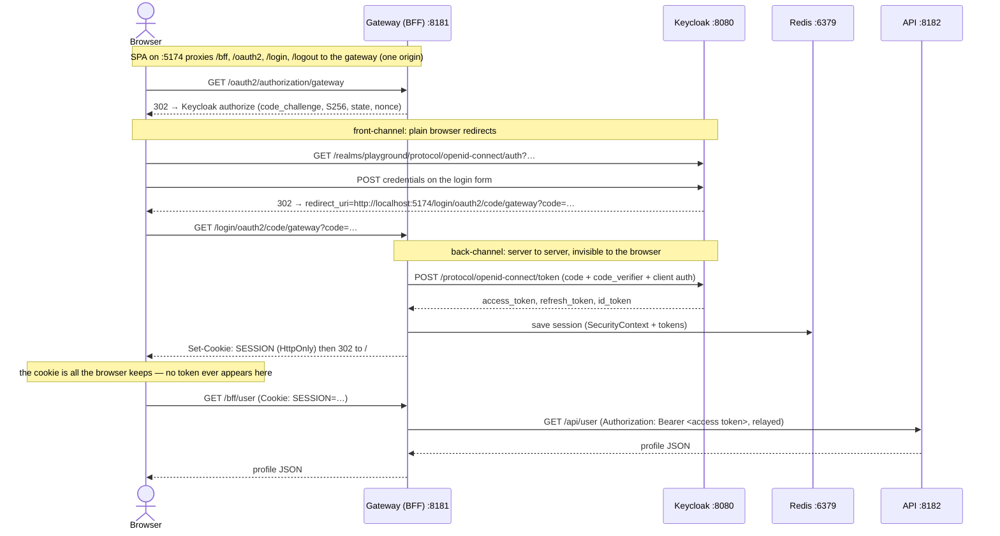

# authn-authz-playground

A learning playground for how a browser, a BFF gateway, and an identity provider
fit together. The core point: the browser never sees tokens. It holds only a
session cookie; tokens live server side. See `PRODUCT.md` for the full plan and
decisions.

Each slice gets one top-level section below. Later slices append their own
without rewriting earlier ones.

---

## S2: BFF login with email/password (default Keycloak theme)

### 1. What S2 delivers

S2 is the email/password login loop through a Backend-for-Frontend (BFF). The
browser starts an OAuth2 authorization code + PKCE flow, but only the gateway
talks to Keycloak: it exchanges the code for tokens on the server side and keeps
them in Redis. What the browser gets back is a single `SESSION` cookie
(HttpOnly) plus a JS-readable `XSRF-TOKEN` cookie for CSRF. From then on the SPA
calls `GET /bff/user` with just the session cookie; the gateway relays the
access token to the API, and the API answers with the user's profile. Logging
out kills both the gateway session and the Keycloak SSO session.



### 2. Prerequisites

Verified on Windows (PowerShell 5.1) on 2026-10-19. On macOS/Linux use the
`./gradlew` and `curl` equivalents (not verified there).

| What | Verified with | Check command | Expected |
| --- | --- | --- | --- |
| JDK | `java` 27 on PATH | `java -version` | Verified with `java` 27 and Gradle's launcher JVM 21; Gradle 9.x needs JVM 17+ (not verified on older JDKs). The build compiles with a **Java 26 toolchain** that Gradle downloads itself (Temurin 26.0.2.1), so a newer JDK on your PATH is fine. |
| Gradle | 9.8.1 via wrapper | `.\gradlew.bat --version` | `Gradle 9.8.1` (no local install needed) |
| Node | v22.20.0 | `node --version` | `v22.x` |
| npm | 10.9.3 | `npm --version` | `10.x` |
| Docker | 28.3.3 + Compose v2.39.2 | `docker --version`; `docker compose version` | Compose v2 subcommand available |

### 3. Run it

All commands are run from the repo root unless stated otherwise.

1. **Start infra** (Keycloak 26.8.1, Redis 8.10, Mailpit v1.31.6):

   ```
   docker compose -f infra/docker-compose.yml up -d --wait
   ```

   Wait for the output to end with `…-keycloak-1  Healthy` (first start runs a
   Quarkus build and can take 2–4 minutes). Confirm:

   ```
   docker compose -f infra/docker-compose.yml ps
   ```

   Expected: `keycloak`, `mailpit`, `redis` all `Up … (healthy)`.

2. **Copy the env placeholders** (optional in dev — docker-compose has
   fallbacks — but this is where secrets belong):

   ```
   copy infra\.env.example infra\.env      (macOS/Linux: cp infra/.env.example infra/.env)
   ```

   `infra/.env.example` names the variables (`GATEWAY_CLIENT_SECRET`,
   `KC_BOOTSTRAP_ADMIN_USERNAME`, `KC_BOOTSTRAP_ADMIN_PASSWORD`). Never commit
   the real `.env`. The realm import resolves `${GATEWAY_CLIENT_SECRET}` inside
   `infra/playground-realm.json`.

3. **Start the API** (the profile endpoint behind the gateway):

   ```
   .\gradlew.bat :api:bootRun
   ```

   Expected: `Tomcat started on port 8182 with context path '/'`.

4. **Start the gateway** (the BFF):

   ```
   .\gradlew.bat :gateway:bootRun
   ```

   Expected: `Netty started on port 8181 (http)`.

5. **Start the SPA**:

   ```
   cd web
   npm install
   npm run dev
   ```

   Expected: `VITE v8.3.4  ready …  ➜  Local:   http://localhost:5174/`.

6. Open **http://localhost:5174/** and click **Sign in**.

Ports in use: Keycloak 8080, Mailpit 8025/1025, Redis 6379, gateway 8181, API
8182, SPA dev server 5174. (8081/8082 were already taken on the dev machine,
which is why the two apps use 8181/8182.)

### Keycloakify login theme

The Keycloak login page is built from `/keycloak-theme` with Keycloakify 11,
Tailwind v4, and the existing shadcn/ui primitives. Build the theme before
starting Keycloak so the provider volume exists:

```
cd keycloak-theme
npm install
npm run build-keycloak-theme
cd ..
docker compose -f infra/docker-compose.yml up -d --wait
```

The realm import sets `loginTheme` to `keycloak-theme`. Google and GitHub
buttons are rendered from Keycloak's identity-provider list. The default
provider credentials are placeholders for local email/password testing. Set
`GOOGLE_CLIENT_ID`, `GOOGLE_CLIENT_SECRET`, `GITHUB_CLIENT_ID`, and
`GITHUB_CLIENT_SECRET` in `infra/.env` to enable those providers.

### Registration and email verification

The theme has a Register page (shadcn Register 07) with Full name, Email,
Password and Confirm password. Email is the username. Verification mail goes to
Mailpit at http://localhost:8025. Try it: open http://localhost:5174, click Sign in, then
Register, submit, open the "Verify email" message in Mailpit, click the link,
and sign in.

The realm import holds the settings (`registrationAllowed`, `verifyEmail`, the
`fullName` user profile attribute, and the registration flow). Import is
skipped when the realm already exists, so an old Keycloak volume keeps its old
settings. Wipe the volume to pick the changes up.

### Default `user` role

The realm import makes `user` part of the realm default roles
(`default-roles-playground`), so every new user gets it with no manual step:
self-registered users and users created by a first Google or GitHub login alike.
A realm imported before this change keeps its old default roles. Fix it once,
without wiping the volume:

```
node infra/fix-default-roles.mjs --dry-run   (shows what would change)
node infra/fix-default-roles.mjs
```

The script adds `user` to the default role composite, which covers every
existing user too, then grants `user` directly to anyone who still lacks it.
Running it again changes nothing.

### Forgot password and verify

The login page links to Forgot Password (themed after shadcn Forgot Password
07). Keycloak emails a reset link to Mailpit at http://localhost:8025. The link
opens Set new password (themed after Reset Password 07). Unknown and known
emails get the same reply, so the page does not reveal which accounts exist.
The realm `smtpServer` block in `playground-realm.json` points at
`mailpit:1025`.

With Keycloak and Mailpit up and the theme jar built, run:

```
node verify.mjs              (macOS/Linux: ./verify)
node verify.mjs enumeration  (one named check; also: reset)
```

It creates a throwaway user, runs the flow over HTTP, deletes the user, and exits
nonzero on any failure. Evidence from the latest run (mail text, last pages,
`run.json`) is in `.shipit/verify/evidence/forgot-password/`.

### Create the Google and GitHub OAuth apps

Do not put provider credentials in `playground-realm.json`, source code, or
chat. Copy `infra/.env.example` to `infra/.env`, then fill in the four
provider variables locally.

Both providers must use this callback URL. It is the Keycloak broker endpoint,
not the gateway callback:

```
http://localhost:8080/realms/playground/broker/google/endpoint
http://localhost:8080/realms/playground/broker/github/endpoint
```

#### Google

1. Open Google Cloud Console and create or select a project.
2. Configure the OAuth consent screen. For this local demo, an External
   audience in Testing mode is sufficient. Add the Google account used for
   testing as a test user.
3. Create an OAuth client under **APIs & Services > Credentials**. Choose
   **Web application**.
4. Add the Google callback URL above to **Authorized redirect URIs**.
5. Copy the generated client ID and client secret to
   `GOOGLE_CLIENT_ID` and `GOOGLE_CLIENT_SECRET`.

The imported provider requests `openid profile email`.

#### GitHub

1. Open GitHub **Settings > Developer settings > OAuth Apps** and choose
   **New OAuth App**.
2. Set an application name and homepage URL such as
   `http://localhost:5174/`.
3. Set **Authorization callback URL** to the GitHub callback URL above.
4. Register the app, copy its client ID to `GITHUB_CLIENT_ID`, and generate
   a new client secret for `GITHUB_CLIENT_SECRET`.

The imported provider requests `read:user user:email`. GitHub accounts must
expose a usable email address for the existing-account linking check. If the
primary email is private, keep the `user:email` scope and confirm that the
provider returns an email address before testing account linking.

Restart Keycloak after changing `infra/.env`. Realm import runs only when the
realm is first created, so an existing local realm must be deleted from the
Keycloak admin console, or its local data volume must be removed, before
changing imported provider settings takes effect. Do not remove a volume that
contains data you need.

### First broker login: link or create

Both providers use Keycloak's standard `first broker login` flow. It handles
the first social login as follows:

- If no Keycloak user has the provider's verified email, Keycloak creates a
  new user. The new user receives the realm's `user` role through the realm
  default roles. An attribute importer mapper on each provider copies the
  provider's `name` into `fullName`, so the Review Profile page is skipped
  (the flow's review setting is `missing`). It still appears, themed as
  "Confirm your details" (`idp-review-user-profile.ftl`), when the provider sends no
  name, for example a GitHub account without a display name.
- If a user with that email already exists, Keycloak does not silently merge
  accounts. It asks the person to authenticate to the existing account, then
  asks for confirmation before linking the Google or GitHub identity to it.
  Use the existing password user (`alice` or `admin`) to exercise this branch.
- If the person declines the link or cannot authenticate the existing account,
  the broker login stops and no account is linked.

After either branch succeeds, Keycloak returns to the same gateway OAuth
callback. The gateway creates the same Redis-backed `SESSION` cookie and
relays the access token to the API, so `/bff/user`, role checks, logout, and
CSRF behavior are the same as for password login. Verify both a new social
account and linking to an existing password account. The provider credentials
are required for this live check.

**Test users** (from `infra/playground-realm.json`, dev only):

| Username | Password | Roles |
| --- | --- | --- |
| `alice` | `alice1234` | user |
| `admin` | `admin1234` | user, admin |

Keycloak admin console: http://localhost:8080 (Administration Console), login
from `KC_BOOTSTRAP_ADMIN_*` in `infra/.env.example`.

### 4. Follow the flow

**a. Open the SPA unauthenticated.**
Visit http://localhost:5174/ with a clean browser profile.
*What to look at:* the page settles on "You are not signed in." with a
**Sign in** button. In DevTools → Network, the page made
`GET /bff/csrf` (200) and `GET /bff/user` (**401**). The 401 is deliberate: the
gateway answers XHR with 401 instead of redirecting to Keycloak, because an XHR
cannot follow the cross-origin redirect chain back (see 7.3). The SPA turns the
401 into the "Sign in" state.

**b. Watch the redirect to Keycloak.**
Click **Sign in** and open DevTools → Network (preserve the log).
*What to look at:*

- `GET /oauth2/authorization/gateway` → **302** (this is the SPA's
  `window.location.assign` in `web/src/App.tsx`)
- `GET http://localhost:8080/realms/playground/protocol/openid-connect/auth?…`
  → 200. Read its query string: `response_type=code`, `client_id=gateway`,
  `redirect_uri=http://localhost:5174/login/oauth2/code/gateway`, `state=…`,
  `nonce=…`, `code_challenge=…`, `code_challenge_method=S256`. The last two are
  PKCE — the gateway generated them in
  `gateway/src/main/java/dev/playground/gateway/SecurityConfig.java`
  (`OAuth2AuthorizationRequestCustomizers.withPkce()`).

**c. Log in and follow the redirect back.**
Sign in as `alice`.
*What to look at:*

- `POST http://localhost:8080/realms/playground/login-actions/authenticate` → 302
- `GET http://localhost:5174/login/oauth2/code/gateway?code=…&state=…` → **302**.
  This request carries the code back to the gateway. Its response headers
  contain `Set-Cookie: SESSION=…; Path=/; HTTPOnly` — the cookie is set **after**
  the server-side code exchange, which you can see as the gateway's outgoing
  `POST …/protocol/openid-connect/token` (visible in the gateway log only; it
  never passes through the browser).
- `GET http://localhost:5174/` → 200, then `GET /bff/user` → **200** with the
  profile JSON.

**d. Inspect the cookies and prove no token is in the browser.**
DevTools → Application → Cookies → `http://localhost:5174`:

| Cookie | HttpOnly | SameSite | Secure | JS can read it? |
| --- | --- | --- | --- | --- |
| `SESSION` | yes | *(not set — browsers default to `Lax`)* | no (plain http) | no |
| `XSRF-TOKEN` | no | *(not set)* | no | yes, by design (Axios reads it) |

Verify in the DevTools console:

```js
localStorage    // {}
sessionStorage  // {}
document.cookie // "XSRF-TOKEN=…" only — the HttpOnly SESSION cookie is invisible
```

*What to look at:* the only credential JS can see is the CSRF token. The access
token, refresh token and id token are not here anywhere — they are in Redis
(step e). (Verified output: both storages empty, `document.cookie` shows only
`XSRF-TOKEN`.)

**e. Look inside Redis.**

```
docker compose -f infra/docker-compose.yml exec redis redis-cli --scan --pattern "spring:session:sessions:*"
```

Expected: one or more `spring:session:sessions:<uuid>` lines. Copy one id and
list its fields (**names only** — the values are JDK-serialized and contain the
tokens, so don't dump them):

```
docker compose -f infra/docker-compose.yml exec redis redis-cli HKEYS spring:session:sessions:<uuid>
```

Expected:

```
maxInactiveInterval
lastAccessedTime
creationTime
sessionAttr:org.springframework.security.oauth2.client.web.server.WebSessionServerOAuth2AuthorizedClientRepository.AUTHORIZED_CLIENTS
sessionAttr:SPRING_SECURITY_CONTEXT
sessionAttr:org.springframework.security.oauth2.client.web.server.WebSessionOAuth2ServerAuthorizationRequestRepository.AUTHORIZATION_REQUEST
```

*What to look at:* `…AUTHORIZED_CLIENTS` holds the OAuth2 tokens,
`SPRING_SECURITY_CONTEXT` holds the logged-in user. That is the whole point of
S2: the tokens live here, not in the browser. `TTL spring:session:sessions:<id>`
shows the idle timeout ticking (30 min by default).

**f. Call the protected endpoint with curl.**
Copy the `SESSION` value from DevTools (it is visible there even though JS
cannot read it) and call (on macOS/Linux use `/dev/null` instead of `NUL`):

```
curl -s -H "Cookie: SESSION=<value>" http://localhost:5174/bff/user
```

Expected (verified):

```json
{"name":"Alice Anderson","preferredUsername":"alice","email":"alice@example.com","roles":["user"]}
```

Without the cookie you get `401`:

```
curl -s -o NUL -w "%{http_code}" http://localhost:5174/bff/user   → 401
```

*What to look at:* the request carries **no** `Authorization` header. The
gateway's `TokenRelay` filter adds the bearer token on the server-side hop to
the API (`GET /api/user` on :8182) — see the route in
`gateway/src/main/resources/application.yml`.

**g. Start a second gateway instance.**
Sessions are in Redis, so any instance can serve them:

```
.\gradlew.bat :gateway:bootRun --args="--server.port=8191"
```

Then, with the same cookie:

```
curl -s -H "Cookie: SESSION=<value>" http://localhost:8191/bff/user
```

Expected: the same profile JSON as step f (verified on both 8181 and 8191).
Stop the second instance afterwards (Ctrl+C).

**h. CSRF: fail without the header, succeed with it.**
CSRF protection is cookie-to-header: the gateway puts the raw token in the
JS-readable `XSRF-TOKEN` cookie; the request must echo it in the
`X-XSRF-TOKEN` header. Fetch a token first (`GET /bff/csrf` writes the cookie),
then try a state-changing request (`POST /logout`) — the request must send
**both** cookies, because the gateway compares the header against the cookie:

```
curl -s -o NUL -w "%{http_code}" -X POST -H "Cookie: SESSION=<value>; XSRF-TOKEN=<xsrf>" http://localhost:5174/logout
```

Without the header → **403** (verified; body `Access Denied`). With
`-H "X-XSRF-TOKEN: <xsrf>"` added → **200** and
`{"logoutUrl":"http://localhost:8080/realms/playground/protocol/openid-connect/logout?id_token_hint=…&post_logout_redirect_uri=http://localhost:5174/"}` (verified).

*Where Axios does this automatically:* `web/src/App.tsx` creates the client
with `xsrfCookieName: 'XSRF-TOKEN'` and `xsrfHeaderName: 'X-XSRF-TOKEN'` — the
Spring Security defaults — so application code never sets the header.

**i. Log out and confirm both sessions are gone.**
Click **Sign out** in the SPA. It `POST`s `/logout` (CSRF-protected), receives
the `logoutUrl`, and opens it as a top-level navigation: Keycloak's
`end_session` (RP-initiated logout) kills the SSO session and redirects back to
`http://localhost:5174/`.
*What to look at:* the SPA shows "You are not signed in."; the Redis key from
step e is gone (`EXISTS spring:session:sessions:<uuid>` → `0`, verified); and
clicking **Sign in** again shows the Keycloak **login form** instead of signing
you straight back in (verified) — the SSO session is dead too.

### 5. Code map

| File | What it does | Read first |
| --- | --- | --- |
| `gateway/src/main/java/dev/playground/gateway/SecurityConfig.java` | The whole BFF security setup: login, logout, CSRF, token relay wiring | `securityWebFilterChain(...)` — note `withPkce()`, the 401 entry point, and the logout success handler |
| `gateway/src/main/resources/application.yml` | OIDC client registration (`gateway`), issuer URL, Redis, routes | the `registration.gateway` block and the `bff-user` route (`SetPath=/api/user` + `TokenRelay`) |
| `gateway/src/main/java/dev/playground/gateway/GatewayApplication.java` | Boots the gateway | `@EnableRedisWebSession` — this is what puts the session in Redis |
| `gateway/src/main/java/dev/playground/gateway/StableSessionSecurityContextRepository.java` | Saves the security context without rotating the session id on token refresh | `principalChanged(...)` — the rotation policy |
| `gateway/src/main/java/dev/playground/gateway/SpaServerCsrfTokenRequestHandler.java` | Resolves the CSRF token from the header (raw) or form field (masked) | `resolveCsrfTokenValue(...)` |
| `gateway/src/main/java/dev/playground/gateway/CsrfController.java` | `GET /bff/csrf` — forces the XSRF cookie to be written | the whole file (7 lines of logic) |
| `api/src/main/java/dev/playground/api/SecurityConfig.java` | Makes the API a JWT resource server | `oauth2ResourceServer(...jwt...)` |
| `api/src/main/java/dev/playground/api/UserController.java` | `GET /api/user` — profile built from the relayed token's claims | `user(@AuthenticationPrincipal Jwt jwt)` |
| `api/src/main/resources/application.yml` | JWT issuer the API validates against | `spring.security.oauth2.resourceserver.jwt.issuer-uri` |
| `web/src/App.tsx` | The SPA: session state, sign in / sign out | the `axios.create` block (`withCredentials`, `xsrfCookieName`, `xsrfHeaderName`) and `loadUser` |
| `web/vite.config.ts` | Dev proxy so the browser sees one origin | `proxy` map: `/api`, `/bff`, `/oauth2`, `/login`, `/logout` → `:8181` |
| `infra/docker-compose.yml` | Keycloak + Redis + Mailpit | the `keycloak` service (`start-dev --import-realm`, healthcheck) |
| `infra/playground-realm.json` | Realm `playground`: `gateway` client, PKCE S256, redirect URIs, test users | the `clients[0]` block and `post.logout.redirect.uris: "+"` |
| `infra/.env.example` | Placeholder names for secrets | copy to `infra/.env`; never commit real values |

### 6. Concepts in this slice

- **Authorization code + PKCE.** The browser only carries a one-time `code`;
  tokens are exchanged server side. PKCE (a `code_challenge` sent on the way
  out, a `code_verifier` sent on the way back) proves the exchange comes from
  the same client even without a secret in the browser. Keycloak enforces S256
  for this client (`pkce.code.challenge.method` in
  `infra/playground-realm.json`), and Spring Security only adds PKCE
  automatically for *public* clients, so the gateway opts in explicitly in
  `SecurityConfig.java` with `OAuth2AuthorizationRequestCustomizers.withPkce()`.
- **Why the gateway is the OAuth2 client.** The `gateway` client id/secret live
  only in `gateway/src/main/resources/application.yml`. The SPA holds no client
  configuration at all. The `TokenRelay` filter (the `bff-user` route in the
  same file) forwards the logged-in user's access token to the API as a bearer
  header, so the browser never needs one.
- **Spring Session + Redis.** `@EnableRedisWebSession` on
  `GatewayApplication.java` swaps the in-memory WebFlux `WebSession` for a
  Redis-backed one. The session cookie is just an id; the session (security
  context **and** the OAuth2 tokens) is stored under
  `spring:session:sessions:<id>` in Redis. That is what makes a second gateway
  instance and a gateway restart both transparent.
- **XSRF cookie-to-header.** With cookie-based sessions, any request the browser
  makes is authenticated — including ones a malicious site triggers. So
  state-changing requests must also carry a token the attacker cannot read. The
  gateway writes it to the readable `XSRF-TOKEN` cookie
  (`CookieServerCsrfTokenRepository.withHttpOnlyFalse()` in
  `SecurityConfig.java`); Axios copies it into the `X-XSRF-TOKEN` header
  (`web/src/App.tsx`); `SpaServerCsrfTokenRequestHandler.java` compares the
  header raw and form-field submissions masked (BREACH hardening).
- **RP-initiated logout.** Killing only the gateway session leaves Keycloak SSO
  alive, so the next sign-in would silently succeed. `POST /logout` ends the
  gateway session and then answers with a `logoutUrl` pointing at Keycloak's
  `end_session` (built by `OidcClientInitiatedServerLogoutSuccessHandler` in
  `SecurityConfig.java`, with `post_logout_redirect_uri` back to the SPA). The
  SPA opens it as a top-level navigation because XHR cannot follow that
  cross-origin redirect chain; Keycloak kills its session and redirects home.
  Back-channel logout (`/logout/connect/back-channel/gateway`, registered in
  `infra/playground-realm.json`) additionally lets Keycloak invalidate the
  gateway session when SSO ends elsewhere.

### 7. Troubleshooting

1. **Keycloak error page: "Invalid redirect uri"** — the redirect or post-logout
   URI the gateway sends is not allowed for the client. Check `redirectUris` and
   `post.logout.redirect.uris` in `infra/playground-realm.json`. Gotcha: the
   realm is imported **only when it does not exist yet**; editing the file does
   nothing to an already-imported realm. To re-import:
   `docker compose -f infra/docker-compose.yml down -v` (destroys all local
   Keycloak data) then `up -d --wait` (not verified in this pass — destructive).
   Another gotcha hit live: `post.logout.redirect.uris` is parsed
   whitespace-separated; a comma-joined list is read as one URI. The file uses
   the special value `+` (= "same as the redirect URIs").
2. **Logged straight back out / cookie not sent.** The `SESSION` cookie is
   host-scoped to `localhost` and path `/`, so any port on `localhost` shares
   it (that is why step g works). It breaks if you move the SPA to a different
   host name, or if you mark the cookie `SameSite=Strict` (the top-level
   redirect back from Keycloak would then not carry it — the cookie is sent
   today because it has no SameSite and browsers default to `Lax`). Check what
   was actually set with `curl -D - -o NUL <url>` and look at `Set-Cookie`.
3. **CORS error in the console** (e.g. `blocked by CORS policy … localhost:8080`)
   — the SPA reached across origins instead of using the Vite proxy. All calls
   must be relative (`/bff/user`, `/oauth2/authorization/gateway`); never
   hard-code `http://localhost:8181` in the SPA. This is also why unauthenticated
   calls return 401 rather than a login redirect (an XHR cannot follow the
   redirect to Keycloak and back), and why logout ends in a top-level
   navigation.
4. **Redis connection refused** (gateway/API fail to start with
   `Connection refused … 127.0.0.1:6379`) — the Redis container is not running.
   `docker compose -f infra/docker-compose.yml up -d redis`, then
   `docker compose -f infra/docker-compose.yml exec redis redis-cli ping` →
   `PONG` (verified).
5. **Keycloak not healthy yet.** First start builds a Quarkus app (the compose
   healthcheck tolerates minutes). The gateway fails fast if it cannot fetch
   `…/realms/playground/.well-known/openid-configuration`. Check
   `docker compose -f infra/docker-compose.yml ps` shows `(healthy)`, then
   `curl -s http://localhost:8080/realms/playground/.well-known/openid-configuration`
   should print JSON whose `issuer` is `http://localhost:8080/realms/playground`
   (verified). The management port `:9000` used by the healthcheck is not
   published to the host — don't try to curl it from outside the container.
6. **Issuer / clock mismatch** (`invalid issuer`, `jwt expired` from the API) —
   the `iss` claim inside the token must equal the exact string the API
   validates (`spring.security.oauth2.resourceserver.jwt.issuer-uri` in
   `api/src/main/resources/application.yml`). If Keycloak is reached through
   another hostname (e.g. `keycloak:8080` from a container) the issuer string
   changes and validation fails. Large clock skew between machines makes `exp`
   checks fail too.
7. **403 on POST, body `Access Denied`** — CSRF. Either the `X-XSRF-TOKEN`
   header is missing, or the request did not carry the `XSRF-TOKEN` cookie the
   server compares against (reproduced and verified in step h). Call
   `GET /bff/csrf` first and send both cookies plus the header. Note a curl
   trap: `curl -L -X POST` keeps POST on the redirected callback and gets the
   same 403 — drop `-X` and let curl convert the redirect to GET like a
   browser does.

### 8. Checklist

S2 "Done when" — the login slice's share of PRODUCT.md's *First useful result →
Acceptance criteria* (item 1 is registration, a later slice) plus the S2
verification list. All passed on 2026-10-19; tick as you re-verify.

- [ ] Login with email/password starts a gateway session and sets a session
      cookie. (4c)
- [ ] A call through the gateway to the protected profile endpoint returns the
      user's profile; the request carries no bearer token; the gateway relays
      the token to the API. (4f)
- [ ] Logging out ends the session and clears the cookie. (4i)
- [ ] With no valid session, the profile call is rejected. (4a, 4f)
- [ ] The session key and its tokens appear in Redis. (4e)
- [ ] No token is visible in browser storage or JS-readable cookies. (4d)
- [ ] A second gateway instance serves the same session. (4g)

### 9. What's next

S3: authorization — roles (`user`/`admin`, already in the realm) enforced on API
and UI routes.

---

## Verification notes (S2)

Commands and claims I could **not** verify:

- macOS/Linux spellings (`./gradlew`, `curl`, `cp`) — everything was run on
  Windows PowerShell with `.\gradlew.bat` and `curl.exe`. The commands above are
  Windows-verified; POSIX equivalents are (not verified) here.
- `docker compose down -v` + full realm re-import (step 7.1) — not run in this
  pass because it is destructive.
- Troubleshooting causes 2 (cookie scoping) and 6 (issuer/clock) were not
  reproduced live; they are derived from the config and browser cookie rules.
  7.3 (CORS), 7.7 (CSRF 403) and the `post.logout.redirect.uris` gotcha in 7.1
  were all reproduced for real.
- The DevTools UI itself (clicking panels) was not driven programmatically; the
  request names, statuses and cookie attributes above were read from real
  traffic (browser tooling and `curl -D`) of the exact flows described.

Places where code and `PRODUCT.md` disagree:

- **Session cookie "SameSite".** PRODUCT.md and the S2 brief describe the
  session cookie as "HttpOnly SameSite"; the actual header is
  `SESSION=…; Path=/; HTTPOnly` with **no SameSite attribute** (verified via
  `curl -D`). Browsers default an unset SameSite to `Lax`, so the behavior
  matches the intent — but the attribute is not there. `Secure` is also absent,
  which is correct for `http://localhost` and must change before any real
  deployment (a non-goal today).
- **"Done when" wording.** PRODUCT.md has no literal "Done when" heading; the
  checklist above is copied from its *Acceptance criteria* list, minus the
  registration item.
- **Next step.** PRODUCT.md's "Next useful step" is registration (feature 2),
  while this README's S3 pointer is authorization, as requested for the slice
  sequence. Reconcile which order you want before S3 starts.
- **Vite proxy paths.** An earlier PRODUCT.md line said the dev server proxies
  `/api` and `/auth`; the code (`web/vite.config.ts`) proxies `/api`, `/bff`,
  `/oauth2`, `/login`, `/logout`. PRODUCT.md was updated to match during S2 —
  if you see the old sentence anywhere, the code is the truth.
# playaround
