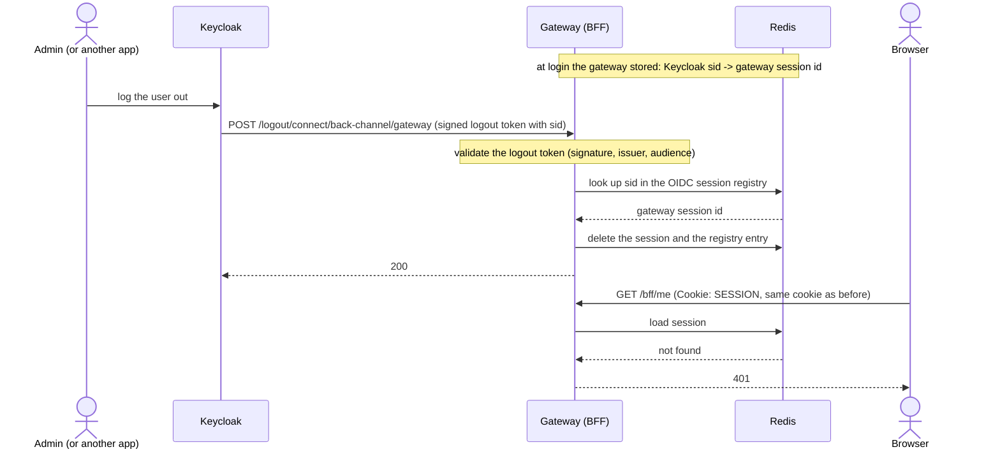

# Back-channel logout

A normal logout starts in the browser (see [Logout](../use-cases/logout.md)).
But a session can also end at Keycloak with no browser involved: an admin logs
the user out, or the SSO session ends from another app. The gateway session
would then live on until it timed out.

OpenID Connect back-channel logout closes that gap. Keycloak calls the gateway
directly.

## What to notice

- **The browser is not part of it.** The cookie in the browser is unchanged.
  It simply names a session that no longer exists, so the next call gets `401`.
- **The registry is in Redis too.** The mapping from the Keycloak session
  (`sid`) to the gateway session lives in Redis beside the sessions. With the
  default in-memory registry, a gateway restart would keep the sessions but
  lose the mapping, and a later Keycloak logout would leave the session alive.
- **The registry holds no tokens.** It stores issuer, audience, subject, `sid`
  and what is needed to end the session.
- **The endpoint is public but only accepts signed tokens.** It takes a logout
  token signed by Keycloak. Anything else is refused.
- **Cookie name matters.** The handler ends the session through the gateway's
  own logout, replaying the session cookie by name. The name is set to
  `SESSION` to match Spring Session.

## Checked by

The `backchannel` smoke check logs a user out through the Keycloak admin API
and then asserts that the Redis session and its registry entry are gone and
that the old cookie gets `401`. See
[Smoke test](https://github.com/vandatnguyen919/playaround/blob/main/README.md#smoke-test).

Decision record: [Logout](../decisions/logout.md).
