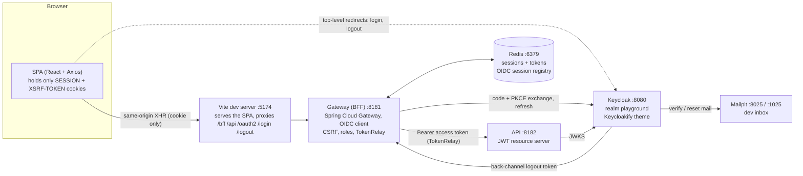

# Architecture

## The big picture

One login and one API call, in eight steps.

Select the drawing to open it full size.

1. The SPA starts login with a full page navigation to the gateway.
2. The gateway runs the authorization code flow with PKCE against Keycloak.
3. Keycloak hands the tokens to the gateway, server to server.
4. The gateway sets the `SESSION` cookie. It is `HttpOnly` and is not a token.
5. The SPA calls the API through the gateway with the cookie only.
6. The gateway finds the session and its tokens in Redis.
7. The `TokenRelay` filter adds the access token as a bearer header.
8. The API verifies the token's signature against Keycloak's keys.

The drawing is an [Excalidraw](https://excalidraw.com) file. Its source is
[`bff-architecture.excalidraw`](pathname:///playaround/img/bff-architecture.excalidraw),
which you can open and edit there.

## Components in local development

Five parts run in local development. The diagram is the one from the
repository README.

## The parts

| Part | Role | What it holds |
| --- | --- | --- |
| **SPA** (React, Vite, Axios) | The user interface. Calls only relative URLs. | Two cookies. No tokens, no OAuth2 client config. |
| **Gateway** (Spring Cloud Gateway) | The BFF. The only OAuth2 client. Checks the session, CSRF and roles, then relays the token. | Nothing of its own: sessions are in Redis. |
| **Redis** | Session store. | The security context, the access and refresh tokens, and the registry used for back-channel logout. |
| **API** (Spring Boot) | A JWT resource server with the protected endpoints. | Nothing. It validates each token against Keycloak's keys. |
| **Keycloak** | The identity provider: login, registration, password reset, Google and GitHub brokering. | Users, credentials, roles. |
| **Mailpit** | A local inbox for verification and reset mail. | Dev mail only. |

## Three rules that shape everything

1. **One origin for the browser.** The browser talks to a single origin. In
   development that is the Vite server, which proxies `/api`, `/bff`,
   `/oauth2`, `/login` and `/logout` to the gateway. There is no CORS to
   configure, and cookies are first party.
2. **Keycloak is reached by redirect only.** The SPA never calls Keycloak with
   XHR. Login and logout are top-level navigations. This is why an
   unauthenticated call gets a plain `401` instead of a redirect: an XHR could
   not follow it across origins.
3. **The bearer token exists on one hop.** It appears only between the gateway
   and the API, inside the server side network.

## Flows

- [Login flow](./login-flow.md): authorization code with PKCE, ending in a
  session cookie.
- [Token relay](./token-relay.md): how a cookie call becomes a bearer call,
  and how refresh happens out of sight.
- [Back-channel logout](./back-channel-logout.md): how Keycloak ends a gateway
  session without the browser.

More detail: the
[Architecture section of the README](https://github.com/vandatnguyen919/playaround/blob/main/README.md#architecture).
