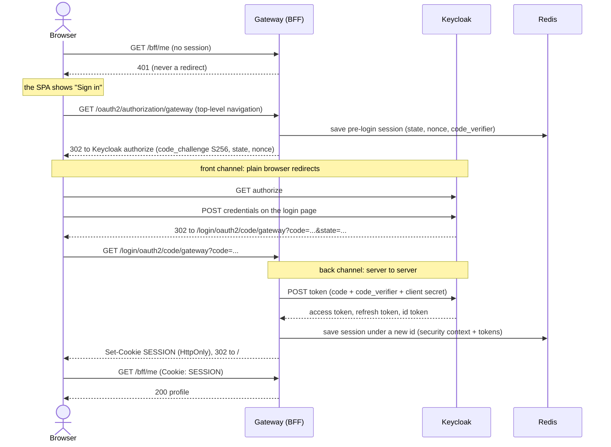

# Login flow

The gateway runs the OAuth2 authorization code flow with PKCE. The browser
only carries a one-time `code` between Keycloak and the gateway. The tokens
are exchanged server to server and never pass through the browser.

## What to notice

- **PKCE even with a client secret.** The gateway is a confidential client, and
  Spring Security adds PKCE on its own only for public clients. The gateway
  opts in, and the realm enforces `S256` for this client.
- **The session id changes at login.** The session that held the authorization
  request gets a new id once the user is signed in, so an id planted before
  login is worth nothing afterwards (session fixation).
- **`SameSite=Lax`, not `Strict`.** The redirect back from Keycloak is a
  top-level navigation that must carry the pre-login session cookie.
- **401, not a redirect, for XHR.** The SPA turns the `401` into a "Sign in"
  state and starts login with a full page navigation.

## Google and GitHub

Social login adds one more redirect in the middle. Keycloak sends the browser
to Google or GitHub, receives the result at its own broker endpoint, and then
continues exactly as above. The gateway cannot tell the difference: it still
receives a `code` from Keycloak and creates the same session. See
[Login](../use-cases/login.md).

## Try it

The README has a step by step tour with the requests to look for in the
browser's network tab, the Redis keys, and `curl` commands:
[Follow the flow](https://github.com/vandatnguyen919/playaround/blob/main/README.md#4-follow-the-flow).

Decision record: [BFF and token relay](../decisions/bff-and-token-relay.md).
