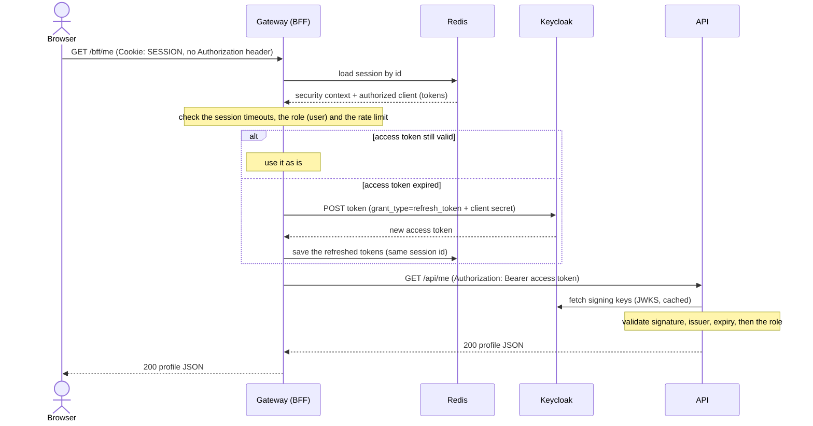

# Token relay to the API

After login the browser calls the gateway with its cookie and nothing else.
The gateway turns that into a call the API can trust.

## What to notice

- **The request from the browser has no `Authorization` header.** The
  `TokenRelay` filter adds it on the server side hop.
- **Two checks, two places.** The gateway checks the role on `/bff/*` before
  it forwards. The API checks the token and the role again. The API does not
  trust the gateway just because the call came from it.
- **Refresh is invisible.** Access tokens live 5 minutes. The gateway
  refreshes them with the refresh token it holds, so a short token lifetime
  costs the user nothing.
- **The session id stays the same on refresh.** If it rotated, parallel
  requests still using the old id would be logged out. The id changes only
  when the signed-in user changes.
- **Sessions are in Redis, not in the gateway's memory.** A second gateway
  instance or a restarted one serves the same cookie.

## When the API is slow or down

The gateway puts a time limit and a circuit breaker in front of the API and
answers with JSON instead of hanging:

| Status | `error` | When |
| --- | --- | --- |
| 504 | `api_timeout` | The API took longer than the time limit. |
| 503 | `api_unavailable` | The circuit is open. Carries `Retry-After`. |
| 502 | `api_error` | The API failed or could not be reached. |
| 429 | | Over the rate limit for this user and route. |

Endpoints and status codes: [API](../api.md). Decision records:
[BFF and token relay](../decisions/bff-and-token-relay.md),
[Sessions in Redis](../decisions/sessions-in-redis.md),
[Gateway hardening](../decisions/gateway-hardening.md).
