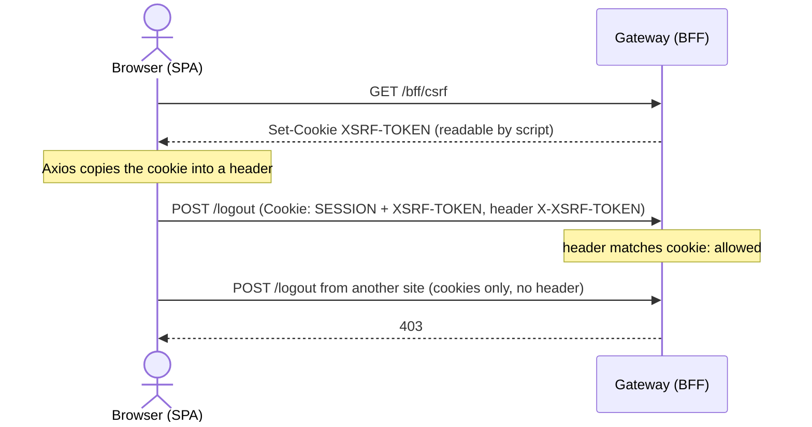

# CSRF and same origin

## Decision

- The browser talks to **one origin**. The gateway serves or proxies the SPA.
  There is no CORS setup for the app, and any other origin is refused.
- CSRF protection is **cookie to header**: the gateway writes the token to a
  readable `XSRF-TOKEN` cookie and expects it back in the `X-XSRF-TOKEN`
  header.

## Why one origin

Cookies are simplest and safest as first party cookies. With one origin there
are no cross-site cookie rules to fight and no CORS allow list to get wrong.
In development the Vite server proxies the gateway's paths, so the browser
still sees a single origin and the redirect URIs are built against it.

Keycloak is a different origin, and it is only ever reached by a top-level
redirect, never by XHR.

## Why CSRF protection at all

A cookie session means the browser authenticates every request to the
gateway, including ones another site triggers. A token in a header would not
have this problem, but the token is exactly what the browser must not hold.
So state-changing requests must also carry a value that another site cannot
read.

Another site can make the browser send the cookies, but it cannot read the
cookie to copy it into the header.

## Details that matter

- **Axios needs no code for this.** Its default cookie and header names are
  the ones Spring Security uses.
- **`XSRF-TOKEN` is not `HttpOnly` on purpose.** Script must read it. It is
  not a credential by itself.
- **The raw token is in the cookie, masked tokens in forms.** This keeps the
  SPA simple while form submissions stay protected against BREACH.

## Trade-off

The SPA must use relative URLs everywhere. A hard-coded gateway address in the
SPA breaks the single origin and shows up as a CORS error.

Full text:
[BFF specifics in PRODUCT.md](https://github.com/vandatnguyen919/playaround/blob/main/PRODUCT.md#bff-specifics).
