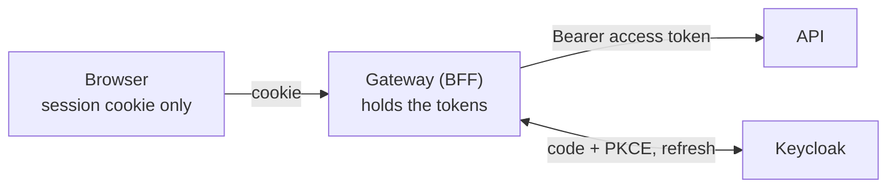

# authn-authz-playground

A learning playground that shows how a browser, a Backend for Frontend (BFF)
gateway, and an identity provider fit together in a modern login setup.

It is a small demo, not a product. Every piece is there to make one idea
visible and checkable.

## The core idea: the browser never sees tokens

In many single page apps the browser runs the OAuth2 flow itself and keeps the
access token in memory or in storage. Any script that runs on the page can then
read it.

This playground does the opposite:

- The **gateway** is the only OAuth2 client. It runs the authorization code
  flow with PKCE against Keycloak and receives the tokens.
- The tokens are stored **server side**, in a session held in Redis.
- The **browser** gets one `HttpOnly` session cookie (`SESSION`) and a CSRF
  cookie (`XSRF-TOKEN`). Neither is a token. Script on the page cannot read the
  session cookie at all.
- When the browser calls the API, it calls the gateway with the cookie. The
  gateway looks up the session, adds the access token as a bearer header, and
  forwards the call. This is the **token relay**.

You can check the claim yourself after signing in: `localStorage` and
`sessionStorage` are empty, and `document.cookie` shows only the CSRF token.

## What it does

A user can:

1. [Register](./use-cases/register.md) with full name, email and password.
2. [Log in](./use-cases/login.md) with email and password, or with Google or
   GitHub.
3. See their profile, returned by a protected API through the gateway.
4. [Reset a forgotten password](./use-cases/forgot-password.md) through an
   emailed link.
5. [Log out](./use-cases/logout.md), which ends the gateway session and the
   Keycloak session.

Two roles, `user` and `admin`, guard the API and the UI routes.

## Where to go next

| If you want to | Read |
| --- | --- |
| See the parts and how they talk | [Architecture](./architecture/index.md) |
| Follow one flow step by step | [Login flow](./architecture/login-flow.md), [Token relay](./architecture/token-relay.md), [Back-channel logout](./architecture/back-channel-logout.md) |
| Know which endpoints exist | [API](./api.md) |
| Run it on your machine | [Running locally](./running-locally.md) |
| Understand why it is built this way | [Decisions](./decisions/index.md) |

## Source of truth

These pages are summaries. The full plan, every decision with its reason, and
the detailed walkthroughs live in the repository:

- [PRODUCT.md](https://github.com/vandatnguyen919/playaround/blob/main/PRODUCT.md):
  purpose, scope, decisions and current state.
- [README.md](https://github.com/vandatnguyen919/playaround/blob/main/README.md):
  how to run it, how to verify it, and a step by step tour of the login flow.

If a page here and one of those files disagree, the file in the repository is
right.
