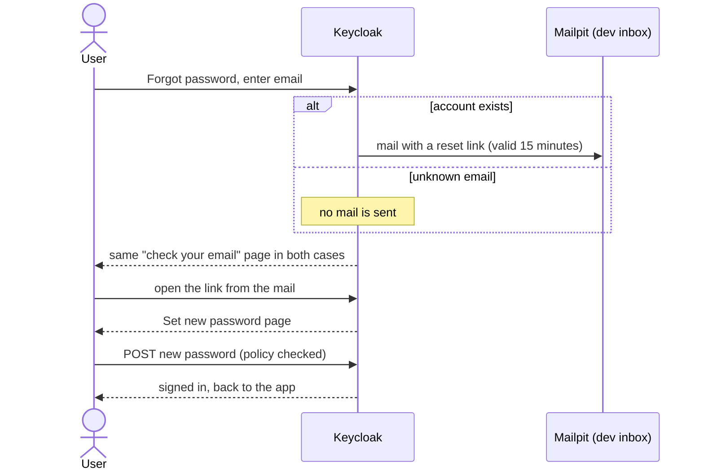

# Forgot password

**Goal:** a user who forgot their password sets a new one through a link sent
to their email.

## Steps

1. On the login page the user chooses **Forgot password** and enters an email.
2. Keycloak answers with the same page whether or not the email has an
   account.
3. If the account exists, Keycloak sends a mail with a reset link. In
   development it lands in Mailpit.
4. The link opens **Set new password**. The user enters and confirms it.
5. The new password works. The old one does not.

## Rules

- **Same answer for known and unknown emails.** The page must not tell who has
  an account.
- **The link works once** and expires after 15 minutes.
- **The password policy applies** to the new password too.
- **Known gap, accepted:** if a user asks for two links, the older unused one
  still works until it expires. Closing it would need custom Keycloak code.
  The limit is pinned by a check. See
  [Auth abuse protection](../decisions/auth-abuse-protection.md).

The gateway is not involved until the user is signed in again. This whole flow
is Keycloak's built-in one with a theme. See
[Password reset](../decisions/password-reset.md) for why there is no emailed
one-time code.

## Checked by

`./verify attacks` runs the reset end to end and the cases around it: unknown
email, link reuse, an expired link, and an older link after a newer one.
Playwright runs the flow in a browser through the mailed link. Table of
checks:
[Forgot password and verify](https://github.com/vandatnguyen919/playaround/blob/main/README.md#forgot-password-and-verify).
