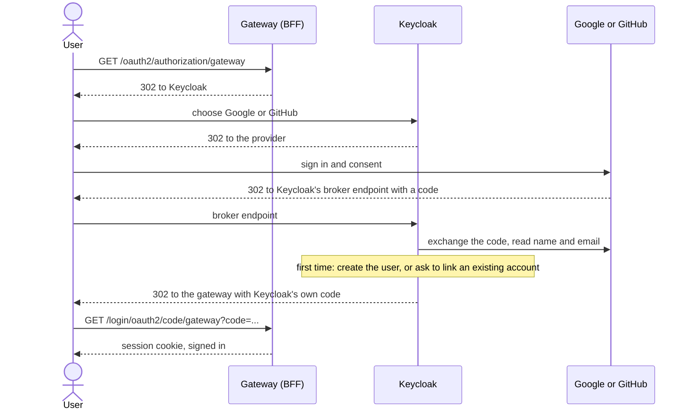

# Login

**Goal:** the user signs in and the app gets a session, without any token
reaching the browser.

## Email and password

1. The user chooses **Sign in**. The SPA navigates the whole page to
   `/oauth2/authorization/gateway`.
2. The gateway redirects to Keycloak. The user enters email and password on
   the themed login page.
3. Keycloak redirects back with a one-time code. The gateway exchanges it for
   tokens, stores them in a Redis session, and sets the `SESSION` cookie.
4. The SPA loads the profile from `/bff/me`.

The full sequence is in [Login flow](../architecture/login-flow.md).

**Wrong password or unknown email** show the same message, so the page does
not reveal which emails have accounts. After 5 failures in a row the account
is locked for a short, growing time, and the locked answer also looks the
same. See [Auth abuse protection](../decisions/auth-abuse-protection.md).

## Google and GitHub

The login page shows **Google** and **GitHub** buttons. Keycloak acts as a
broker: it sends the user to the provider, receives the result, and then
continues the normal flow back to the gateway.

What happens on the first social login:

- **No account with that email:** Keycloak creates one. The provider's display
  name becomes the full name, and the user gets the `user` role.
- **An account with that email exists:** Keycloak does not merge silently. The
  user must prove they own the existing account, then confirm the link.
- **The provider sent no name:** a themed "Confirm your details" page asks for
  it.

From the gateway's point of view nothing changes. It only ever talks to
Keycloak, so the session, role checks, CSRF and logout work the same.

:::note Needs your own OAuth apps
The provider credentials in the repository are placeholders. To try social
login you create your own Google and GitHub OAuth apps and put their client
ids and secrets in your local environment file. The README explains how:
[Create the Google and GitHub OAuth apps](https://github.com/vandatnguyen919/playaround/blob/main/README.md#create-the-google-and-github-oauth-apps).
:::

## Checked by

The smoke test drives the real login over HTTP and asserts that the session is
in Redis, that `/bff/me` works with the cookie alone, and that no JWT appears
in any app cookie or response. Playwright covers login and a wrong password in
a real browser.
