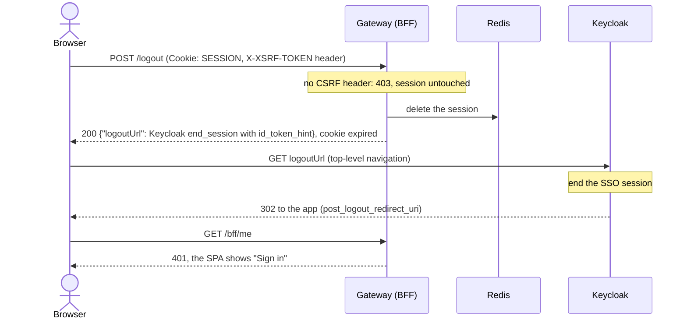

# Logout

**Goal:** signing out ends the session in the app **and** at Keycloak, so the
next sign-in asks for the password again.

Ending only the gateway session is not enough. The Keycloak SSO session would
still be alive, and the next **Sign in** would log the user straight back in.

## Steps

1. The user chooses **Sign out**. The SPA sends `POST /logout` with the CSRF
   header.
2. The gateway deletes its session from Redis and expires the cookie.
3. The gateway answers `200` with JSON that holds Keycloak's end-session URL.
4. The SPA opens that URL as a top-level navigation.
5. Keycloak ends its SSO session and redirects back to the app.

## Why JSON and not a redirect

Spring Security's default answers `POST /logout` with a redirect to Keycloak.
The SPA sends that POST with XHR, and an XHR cannot follow a redirect chain
across origins. So the gateway hands the URL back as data and the SPA
navigates to it. Login works the same way for the same reason.

## Why the CSRF header

The session rides on a cookie, and browsers attach cookies to requests that
other sites trigger. A state-changing request must also carry a value another
site cannot read. The gateway writes it into the readable `XSRF-TOKEN` cookie
and Axios copies it into the `X-XSRF-TOKEN` header. See
[CSRF and same origin](../decisions/csrf-and-same-origin.md).

## Logout that starts elsewhere

If the session ends at Keycloak first, Keycloak tells the gateway directly.
See [Back-channel logout](../architecture/back-channel-logout.md).

## Checked by

Smoke checks `csrf` (403 without the header, the session survives) and
`logout` (cookie expired, Redis session deleted, the next sign-in shows the
login form). Decision record: [Logout](../decisions/logout.md).
