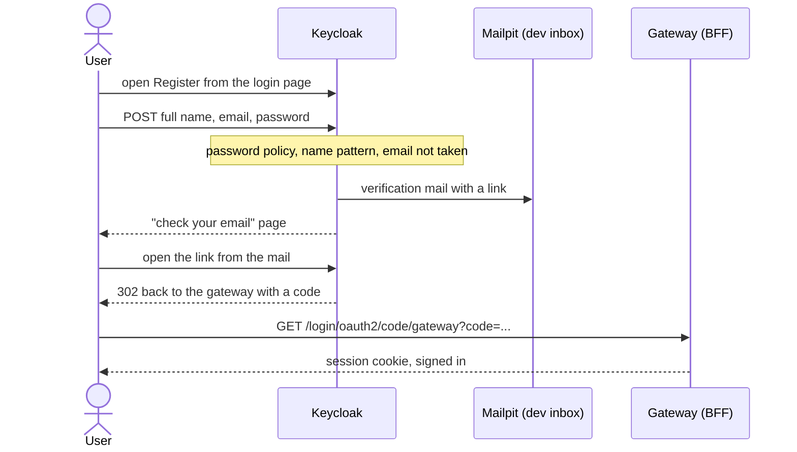

# Register

**Goal:** a new user creates an account with full name, email and password.

## Steps

1. On the app, the user chooses **Sign in**, then **Register** on the Keycloak
   page.
2. The form asks for **Full name**, **Email**, **Password** and **Confirm
   password**. The email is the username.
3. Keycloak creates the user and sends a verification mail. In development it
   lands in Mailpit.
4. The user opens the link in the mail. The account is now verified and the
   user is signed in.

## Rules

- **One name field.** The realm's user profile has a single required
  `fullName` attribute. It reaches the app as the standard `name` claim. See
  [Registration full name](../decisions/registration-full-name.md).
- **Password policy.** At least 8 characters, and not equal to the email.
- **Default role.** Every new user gets the `user` role with no manual step.
- **Taken email.** Registration says when an email already exists. This is a
  known, accepted trade-off, bounded by a rate limit in the deployed setup.
  See [Auth abuse protection](../decisions/auth-abuse-protection.md).

## Checked by

The Playwright suite registers a user, reads the verification mail from the
Mailpit API, follows the link and lands signed in. The attack checks pin that
a taken email creates nothing and sends nothing.

More: [Registration and email verification](https://github.com/vandatnguyen919/playaround/blob/main/README.md#registration-and-email-verification)
in the README.
