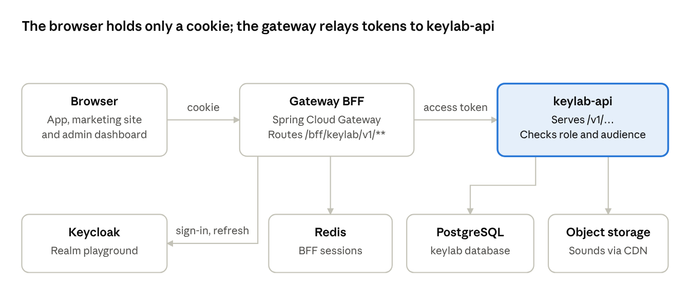
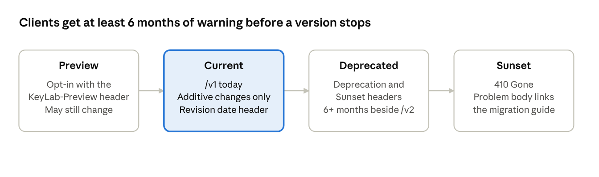

<!-- Exported from the Claude Doc "KeyLab — REST API design (v1)" (https://claude.ai/artifact/UGBCRwSEhe4XSDEigfEq2N) on 2026-11-12. The repo copy is the one to keep current. -->

# KeyLab — REST API design (v1)

Nov 8, 2026 · @Dat

## Summary

KeyLab gets one resource-oriented JSON API, **`/v1`**, served by a new `keylab-api` service behind the existing Spring Cloud Gateway BFF. The browser never holds a token: it calls `https://keylab.app/bff/keylab/v1/…` with its session cookie, and the gateway relays an access token to `keylab-api`, which answers at `/v1/…`.



> Diagram, in words: Browser → (cookie) → Gateway BFF (Spring Cloud Gateway, routes /bff/keylab/v1/**) → (access token) → keylab-api (serves /v1/…, checks role and audience). The BFF signs in and refreshes against Keycloak (realm playground) and keeps sessions in Redis; keylab-api uses PostgreSQL (keylab database) and object storage (sounds via CDN).

The gateway signs people in with Keycloak and keeps the tokens in its Redis session; `keylab-api` only ever sees a bearer token. Sound files go straight from the CDN to the browser.

The same API serves three clients, told apart only by Keycloak roles:

| Client | Who | Role | Reaches |
| --- | --- | --- | --- |
| App and marketing site | Guests | none (anonymous) | Public `GET`s: catalog, shared builds, public profiles, plans |
| App | Members | `keylab-user` | Everything under `/v1/me/…` plus writes on their own builds, likes, follows, collections |
| Admin dashboard | Team | `keylab-viewer` < `keylab-editor` < `keylab-admin` | `/v1/admin/…`, each endpoint marked with the lowest role it needs |

How to read this doc: every endpoint has an ID (`CAT-01`, `BLD-04`, …) and every user story an ID (`US-01` … `US-44`). Endpoint tables list the stories they serve, and the story table at the end lists the endpoints each story needs, so search either ID to jump both ways. `users.id` is the Keycloak `sub`, as in [the KeyLab database design](database-design.md).

## Versioning

The major version lives in the path (`/v1`, later `/v2`) and changes only for a breaking change; everything else ships inside the current version as an additive change.

Why the path and not a header: the gateway routes `/bff/keylab/v1/**` and `/bff/keylab/v2/**` to different deployments if needed, the CDN caches public catalog responses per version without `Vary`, and the version is visible in logs and links people share.



> Diagram, in words: Preview (opt-in with the KeyLab-Preview header, may still change) → Current (/v1 today, additive changes only, revision date header) → Deprecated (Deprecation and Sunset headers, 6+ months beside /v2) → Sunset (410 Gone, problem body links the migration guide).

Each major version moves through four stages; only the Current stage carries the stability promise.

**What is additive (no new version):**

- New endpoints, new optional query parameters, new optional request fields.
- New response fields. Clients must ignore fields they don’t know.
- New enum values, such as a fifth sound profile. Clients must treat an unknown value as “other”.
- Looser validation (a longer bio limit).

**What is breaking (needs `/v2`):**

- Removing or renaming a field, endpoint or enum value.
- Changing a field’s type, meaning or default.
- Making an optional field required, or tightening validation.
- Changing status codes, pagination style, error format or the auth model.

**How a version is retired:**

1. `/v2` ships next to `/v1`. Both run from the same codebase, with `/v1` adapters over the new model.
2. Every `/v1` response gains `Deprecation: @<unix time>` ([RFC 9745](https://www.rfc-editor.org/rfc/rfc9745)), `Sunset: <HTTP date>` ([RFC 8594](https://www.rfc-editor.org/rfc/rfc8594)) and `Link: <…/migrate-to-v2>; rel="deprecation"`.
3. `/v1` keeps working for at least 6 months after `/v2` is generally available (open question: confirm the window).
4. After the sunset date `/v1` answers `410 Gone` with a problem body that links the migration guide.

A single field can be deprecated inside a version the same way: it is marked `deprecated: true` in the OpenAPI file, keeps working, and is removed only in the next major version.

**Revisions inside v1.** Every response carries `KeyLab-API-Revision: 2026-11-08`, the date of the last additive release. It is informational only, and the public changelog is keyed by it. Unfinished endpoints are opt-in with `KeyLab-Preview: <feature>`, and have no stability promise until they graduate.

Sound files and images are content-addressed URLs (`/assets/sounds/<sha256>.wav`, `/assets/photos/<sha256>.png`), so they are not versioned and never change once published. Until an object store and CDN exist, keylab-api serves them itself at `/v1/assets/…`, so the browser loads them from the app's own origin (US-38); recordings are kept as the checked WAV, not transcoded to Opus.

## Conventions

Every endpoint follows the same rules for auth, shape, paging, concurrency and errors, so the tables below list only what differs.

| Topic | Rule |
| --- | --- |
| Auth | Browser sends the BFF session cookie (`HttpOnly`, `SameSite=Lax`). Unsafe methods also send `X-XSRF-TOKEN`. `keylab-api` is an OAuth2 resource server and accepts only tokens whose audience is `keylab-api`. |
| Format | JSON, UTF-8, `camelCase` fields. Timestamps are RFC 3339 in UTC. |
| Naming | Follows the [REST API standards](https://github.com/vandatnguyen919/api-docs/blob/main/rest-api-standards.md): paths are lower-case plural nouns with hyphens (`/keycap-sets`), path parameters and query parameters are `snake_case` (`{build_id}`, `keycap_set`), and a filter that takes several values repeats a singular parameter (`?mod=foam&mod=tape`). Body fields stay `camelCase`. |
| IDs | UUIDv7 for private records. Public catalog items also have a stable `slug` (`/v1/switches/milk-yellow`). Users are addressed by `username` in public URLs and by `me` for the caller. |
| Lists | `{ "data": […], "page": { "nextPageToken": "…", "pageSize": 24 } }`. Cursor paging with `page_size` (default 24, max 100) and `page_token`. Sorting with `sort=-createdAt`. Filters are plain query parameters. |
| Embedding | `include=` pulls related records into one response, for example `include=sounds,forceCurve` on a switch. |
| Create | `201 Created` with `Location` and the new resource. `Idempotency-Key` header accepted on every create and required on checkout; replays within 24 h return the first result. |
| Update | `PATCH` with JSON Merge Patch (`application/merge-patch+json`, RFC 7396). `PUT` only for idempotent set or unset, such as like and follow. |
| Concurrency | `GET` returns an `ETag`. `PATCH` and `DELETE` on builds, profiles and catalog items require `If-Match`; a stale tag gets `412`. |
| Async work | Sound processing, data export and share-image rendering answer `202 Accepted` with a `Location` to poll. |
| Caching | Public catalog and shared builds: `Cache-Control: public, max-age=300` plus `ETag`. Anything under `/me` or `/admin`: `private, no-store`. |
| Rate limits | Per session and per IP, numbers to be set. Over the limit: `429` with `Retry-After`. |
| Errors | `application/problem+json` ([RFC 9457](https://www.rfc-editor.org/rfc/rfc9457)) with a stable `code`; validation errors list each field. |

Where KeyLab departs from the REST API standards on purpose:

- **Paging is cursor-only.** No `page`, `totalItems` or `totalPages`: feeds change while people scroll. The standard allows this through `page_token`.
- **Lists use `data` and `page`**, not a named array with HATEOAS `links`. There is one first-party client.
- **Sort is `sort=-createdAt`**, not `sort=created_at|desc`, so the value needs no percent-encoding.
- **`Idempotency-Key`**, not `x-idempotency-id`: it is the IETF draft name and the one payment providers use.
- **No namespace segment** after `/v1`. KeyLab is a single API.

A validation error looks like this:

```json
{
  "type": "https://keylab.app/problems/validation",
  "title": "Some fields need a fix",
  "status": 422,
  "code": "validation_failed",
  "errors": [
    { "pointer": "/username", "code": "username_taken", "message": "@clackattack is taken. Try another." },
    { "pointer": "/links/website", "code": "invalid_url", "message": "Start with https:// and include a domain." }
  ]
}
```

Error codes every endpoint can return, from the shared helpers:

| Status | `code` | When |
| --- | --- | --- |
| 400 | `invalid_page_size`, `invalid_page_token` | `page_size` outside 1 to 100, or a `page_token` this API did not issue. |
| 400 | `if_match_required` | A change that needs `If-Match` came without it. |
| 412 | `precondition_failed` | `If-Match` does not match the current `ETag`. |
| 400 | `invalid_idempotency_key` | `Idempotency-Key` longer than 64 characters. |
| 422 | `idempotency_key_reused` | The same `Idempotency-Key` within 24 h with a different request body. |
| 409 | `idempotency_in_progress` | The first request with that key is still running. |
| 401 / 403 | `unauthenticated` / `forbidden` | No valid token (wrong audience included), or a missing role. |
| 502 / 503 / 504 | `api_error` / `api_unavailable` / `api_timeout` | Written by the gateway when keylab-api fails, its circuit is open (with `Retry-After`), or it is too slow. |

`GET /v1/health` (**SYS-01**, public, module `shared`) returns `{ status, revision, authenticated, roles }` for the
caller. It is the KL0 smoke call through the BFF and is not tied to a story.

Status codes the client must handle: `200`, `201`, `202`, `204`, `400` bad syntax, `401` no session, `403` wrong role or private resource, `404`, `409` state conflict (publish without sounds, fifth featured slot), `410` sunset version, `412` stale `If-Match`, `422` validation, `429`.

## Catalog (CAT)

The catalog is read-only and public: only published items appear, and admins change it through `/v1/admin` (ADM).

| ID | Endpoint | What it does | Access | Stories |
| --- | --- | --- | --- | --- |
| CAT-01 | `GET /v1/switches` | List published switches. Filters: `type` (linear, tactile, clicky, silent), `profile` (deep, poppy, clacky, muted), `sound` (recorded, missing), `q` (name or brand), `is_new`, `force_min` and `force_max` (grams, inclusive). Sort: `popular`, `-publishedAt`, `force`. | Public | US-02, US-03, US-39 |
| CAT-02 | `GET /v1/switches/{slug}` | One switch: specs (force g, actuation and travel mm, spring, stem colour, housing), force curve points, sound summary. `include=sounds,related`. | Public | US-03, US-04 |
| CAT-03 | `GET /v1/switches/{slug}/sounds` | Recordings by variant (stock, lubed, foam) and stroke (press, release): CDN URL, `durationMs`, `loudnessLufs`, waveform peaks. A switch with no recording returns `[]` and `soundStatus: "missing"`. | Public | US-03, US-04 |
| CAT-04 | `GET /v1/switches/{slug}/related` | Switches that sound similar, for “Sounds similar”. | Public | US-04 |
| CAT-05 | `GET /v1/keycap-sets` | Keycap sets: material, profile, colours, and the sound shift on the deep ↔ bright scale. | Public | US-06 |
| CAT-06 | `GET /v1/keycap-sets/{slug}` | One keycap set with its colourway for the keyboard preview. | Public | US-06 |
| CAT-07 | `GET /v1/mods` | Mods with their effect on pitch, thock, volume and rattle, and the levels a mod offers (lube: none, light, heavy). | Public | US-05 |
| CAT-08 | `GET /v1/case-options` | Case materials, colours, plates and mount styles, each with its sound effect. | Public | US-07 |

CAT-01 details (US-39, US-02): only `status = 'published'` rows, so drafts and pulled switches never show. `popular` lists the newest first until play counts exist. A bad filter value is `400 invalid_parameter`; a `page_token` from another sort is `400 invalid_page_token`. The `ETag` is a hash of the body, and a matching `If-None-Match` gets `304`, so a change shows within one cache window (300 s).

CAT-02 to CAT-04 details (US-04): published switches only; a draft, a pulled switch or an unknown slug is `404 switch_not_found`. CAT-02 `include` takes `sounds`, `related` or both, anything else is `400 invalid_parameter`; `soundSummary.word` names the profile ("Deep & rounded", "Bright & poppy", "Sharp & clacky", "Soft & muted"). CAT-03 lists ready recordings, stock then lubed then foam, press before release. CAT-04 ranks by the same sound profile, then the same type, then recorded before missing, then the nearest actuation force; it is one page of four by default (`page_size` up to 100, `nextPageToken` always null). All three are cached like CAT-01.

A switch in a list response:

```json
{
  "id": "0193f2c4-7a1e-7c5b-9d2e-4f8a1b3c5d6e",
  "slug": "coral-pop",
  "name": "Coral Pop",
  "brand": "Clack Works",
  "type": "tactile",
  "profile": "poppy",
  "stemColor": "#F16B53",
  "forceG": 62,
  "actuationMm": 2.0,
  "travelMm": 3.8,
  "soundStatus": "recorded",
  "isNew": true,
  "publishedAt": "2026-11-02T03:42:00Z"
}
```

## Builds and playground (BLD)

A build stores choices, not sound: switch, variant, mods, keycap set and case. The sound comes from one shared endpoint (BLD-10), so the builder, the playground and a shared link all play it the same way.

| ID | Endpoint | What it does | Access | Stories |
| --- | --- | --- | --- | --- |
| BLD-01 | `GET /v1/me/builds` | My builds, public and private. Filter `visibility`. | Member | US-08 |
| BLD-02 | `POST /v1/builds` | Save a build from the builder. Starts private unless `visibility: "public"`. | Member | US-08 |
| BLD-03 | `GET /v1/builds/{id}` | One build. Public builds are open to everyone; private ones only to the owner (others get `404`). | Public or owner | US-09, US-14, US-19 |
| BLD-04 | `PATCH /v1/builds/{id}` | Rename, change parts, set `visibility`. Needs `If-Match`. | Owner | US-08, US-12 |
| BLD-05 | `DELETE /v1/builds/{id}` | Delete a build. If it is the daily driver, the profile’s pin is cleared. | Owner | US-12 |
| BLD-06 | `POST /v1/builds/{id}/copies` | Copy someone’s public build into my builds to remix. Credits the source in `copiedFrom`. | Member | US-15 |
| BLD-07 | `GET /v1/builds/{id}/parts-list` | Parts and quantities (case, plate, PCB, switches + 4 spares, keycaps, stabilizers, mods). Shop links are a placeholder. | Public or owner | US-10 |
| BLD-08 | `GET /v1/builds/{id}/share-image` | The share card as `image/png`. Rendered on first request, then cached until the build changes. | Public or owner | US-11 |
| BLD-09 | `POST /v1/me/builds/imports` | After sign-up, saves the builds a guest made in local storage (up to 3). | Member | US-13 |
| BLD-10 | `GET /v1/sound-recipe` | Which samples to play and the filter settings for a set of parts: `switch`, `variant`, `mod` (repeatable), `keycap_set`, `case_material`, `plate`, `mount`. Also returns the meter position and word (“Deep & rounded”). Cacheable, so the builder can call it on every toggle. | Public | US-05, US-06, US-07, US-09, US-14, US-19 |

BLD-10 details ([decision 0001](decisions/0001-sound-recipe.md)): computed on the server by the `catalog` module, which holds every input (each part's `sound_fx` and the switch's ready recordings), so the call never leaves the module. `switch` is required; `variant` defaults to `stock`; a part left out adds no effect. Each `mod` value is `slug` for a toggle mod or `slug:level` for a level mod (`?mod=case-foam&mod=lube:light`). The answer does not depend on parameter order, but the cache key is the URL, so the client sorts the `mod` values to make equal mixes share one entry. Every part that was ever published resolves, pulled or retired ones included, so an old shared build still plays; the builder only offers live parts. `samples` are the press and release of the chosen variant, or the stock ones when that variant has no ready take (each sample names its `variant`). Answers carry `Cache-Control: public, max-age=300` and an `ETag` (a hash of the body); a matching `If-None-Match` gets `304`, so a catalog edit shows within one cache window. Errors: a missing `switch`, a parameter given twice (other than `mod`), an unknown `variant`, a malformed or repeated `mod` value is `400 invalid_parameter`; a slug that never named a published part is `422 part_not_found`, a level mod without a level `422 level_required`, a level the mod does not offer `422 level_not_offered`, with one entry in `errors` per bad part whose `pointer` names the parameter (`/switch`, `/mod/1`, `/plate`). A build's save keeps the recipe's filters and meter in `config.sound` (database-design.md), computed by the same code.

The build body that BLD-02 accepts and BLD-03 returns:

```json
{
  "name": "Night Thock 65",
  "visibility": "public",
  "layout": "65",
  "switch": { "slug": "milk-yellow", "variant": "lubed" },
  "mods": [ { "slug": "lube", "level": "light" }, { "slug": "case-foam" }, { "slug": "stab-tuning" } ],
  "keycaps": { "set": "navy-mustard", "profile": "cherry", "material": "pbt" },
  "case": { "material": "aluminum", "color": "#2B4677", "plate": "brass", "mount": "gasket" },
  "deskPad": "sky"
}
```

## Profiles, social and community (ME, SOC)

The caller is always `/v1/me`; anyone else is `/v1/users/{username}`. A private profile returns `200` with `restricted: true` and only the header fields, so the app can show the private state; an unknown username returns `404`.

**Me**

| ID | Endpoint | What it does | Access | Stories |
| --- | --- | --- | --- | --- |
| ME-01 | `GET /v1/me` | My profile, plan, roles, sound signature, stats, daily driver, badges and which tabs are public. | Member | US-16 |
| ME-02 | `PATCH /v1/me/profile` | Display name (≤ 40), username (3–20, `a-z 0-9 . _`), bio (≤ 160), location, links (website, YouTube, Instagram, Discord), `dailyDriverBuildId` (must be my public build), `publicTabs`. Needs `If-Match`. A taken username is `409 username_taken`. | Member | US-24, US-26 |
| ME-03 | `GET /v1/usernames/{username}/availability` | `{ "available": false, "reason": "taken" }`, for the live check while typing. Rate limited. | Member | US-24 |
| ME-04 | `POST /v1/me/avatar/uploads` then `PUT /v1/me/avatar` | Get a presigned upload URL (PNG or JPG, ≥ 400 × 400 px), then set it with the crop `{ uploadId, crop: { x, y, size } }`. | Member | US-25 |
| ME-05 | `DELETE /v1/me/avatar` | Back to initials on the chosen colour. | Member | US-25 |
| ME-06 | `PUT /v1/me/onboarding` | The three onboarding answers: experience, favourite sound profile, layout. | Member | US-01 |

**Other people and community**

| ID | Endpoint | What it does | Access | Stories |
| --- | --- | --- | --- | --- |
| SOC-01 | `GET /v1/users/{username}` | Public profile: header, stats, sound signature, daily driver, badges, public tabs, and `following` / `followsYou` for the caller. | Public | US-16, US-17, US-19, US-20 |
| SOC-02 | `GET /v1/users/{username}/builds` | Their public builds (all of mine when it is me). | Public | US-17 |
| SOC-03 | `GET /v1/users/{username}/likes` | Builds they liked. `403 tab_private` when they hide the Liked tab. | Public | US-21 |
| SOC-04 | `GET /v1/users/{username}/collections` | Their collections; private ones only for the owner. | Public | US-17, US-22 |
| SOC-05 | `GET /v1/collections/{id}` | One collection with its builds and switches. | Public or owner | US-17, US-22 |
| SOC-06 | `GET /v1/users/{username}/activity` | Timeline: published, tried a switch, followed, liked, badge, collection. Hidden when “Show my activity” is off. | Public | US-17 |
| SOC-07 | `PUT` / `DELETE /v1/me/following/{username}` | Follow or unfollow. On a private profile `PUT` answers `202` with `status: "requested"`. | Member | US-18 |
| SOC-08 | `GET /v1/users/{username}/followers` and `/following` | Paged lists of people. | Public | US-18 |
| SOC-09 | `PUT` / `DELETE /v1/me/likes/{build_id}` | Like or unlike a build. | Member | US-21 |
| SOC-10 | `POST /v1/me/collections`, `PATCH` / `DELETE /v1/collections/{id}`, `POST /v1/collections/{id}/items`, `DELETE /v1/collections/{id}/items/{item_id}` | Create, rename, change visibility, delete; add or remove a build or switch. | Owner | US-22 |
| SOC-11 | `GET /v1/community/builds` | Community gallery. `filter=featured` returns the 4 featured slots in order; also `new` and `popular`. Each item carries its author. | Public | US-20 |
| SOC-12 | `POST /v1/reports` | Report a build or a profile: `{ targetType, targetId, reason, note }`. Lands in the moderation queue. | Member | US-23 |
| SOC-13 | `PUT` / `DELETE /v1/me/blocks/{username}`, `GET /v1/me/blocks` | Block, unblock, list. A blocked user gets `404` on my profile. | Member | US-23 |

## Account, settings and billing (ACC)

Keycloak owns credentials: changing email or password, and linking Google or Apple, are redirects through the gateway to Keycloak flows, not `keylab-api` endpoints. Card details never touch KeyLab; the payment provider hosts checkout and the billing portal.

| ID | Endpoint | What it does | Access | Stories |
| --- | --- | --- | --- | --- |
| ACC-01 | `GET` / `PATCH /v1/me/settings` | `sound` (masterVolume 0–100, defaultAmbient none, rain, cafe or office, muteOnStartup), `notifications` (likes, follows, comments, productNews), `privacy` (profileVisibility public, followers or private, showActivity, allowTrySetup). | Member | US-27, US-28, US-29 |
| ACC-02 | `GET /v1/me/identities`, `DELETE /v1/me/identities/{provider}` | Linked sign-ins read from Keycloak. Unlinking the last way to sign in is `409 last_identity`. Linking: `GET /bff/keylab/link/{google\|apple}`. Email and password: `GET /bff/keylab/account/{email\|password}`. | Member | US-30 |
| ACC-03 | `GET /v1/me/subscription` | Plan (`free` or `pro`), interval, status, `renewsAt`. | Member | US-31 |
| ACC-04 | `POST /v1/billing/checkout-sessions` | `{ "plan": "pro", "interval": "yearly" }` → `{ "url": "…" }` to the provider’s checkout. `Idempotency-Key` required. | Member | US-31 |
| ACC-05 | `POST /v1/billing/portal-sessions` | Link to the provider’s portal to update the card or cancel. | Member (Pro) | US-32 |
| ACC-06 | `GET /v1/me/invoices`, `GET /v1/me/invoices/{id}/pdf` | Invoices, newest first; amounts in minor units with currency. | Member | US-32 |
| ACC-07 | `GET /v1/plans` | Public plan list for the pricing page and the upgrade card: features, monthly and yearly prices from the provider. | Public | US-31 |
| ACC-08 | `POST /v1/billing/webhooks` | Provider events (paid, renewed, cancelled). Called by the provider directly, not through the BFF; checked by signature. | Provider | — |
| ACC-09 | `POST /v1/me/exports`, `GET /v1/me/exports/{id}` | Start a ZIP export of builds, collections and settings → `202`; poll, then a short-lived download link is also emailed. | Member | US-33 |
| ACC-10 | `DELETE /v1/me` | Body `{ "confirm": "DELETE" }`; needs a sign-in in the last 5 minutes (else `401 reauth_required`). Answers `202` and deletes after a 14-day grace period; signing in again cancels it. | Member | US-34 |

## Admin (ADM)

Everything under `/v1/admin` needs at least `keylab-viewer`; each row names the lowest role that may call it, and every write records an audit event (ADM-13). A switch is a draft until it is published, and publishing is refused (`409 missing_required_sounds`) until the stock press and release recordings are ready.

ADM-02 details (US-37): a switch is created as a draft and only editors see it. `PATCH` merges, then checks the whole result as a create would, so one `422` lists every field to fix (`/forceCurve/2/travelMm` points at a single curve point). Limits: name and brand up to 60 characters, force 10 to 150 g, travel 0.5 to 6 mm, actuation 0.1 mm up to below the travel, up to 50 curve points within the travel at 0 to 250 g, no two points of one stroke at the same travel. A draft's `slug` follows its name (`coral-pop`, then `coral-pop-2`); a published one keeps it. `DELETE` is for drafts only (`409 switch_not_draft`); a published switch is pulled with ADM-03 instead, because builds may use it. `photoUploadId` names a received `switch_photo` upload (ADM-04, US-38): a square PNG or JPG of at least 800 px, else `422` at `/photoUploadId` (`upload_not_found`, `upload_not_received`, `upload_already_used`, `upload_wrong_purpose`, `photo_not_square`, `photo_too_small`); `null` clears the photo. The list (`GET /v1/admin/switches`) returns drafts too, by name, with `q`; US-36 adds its other filters. Unknown or malformed ids are `404 switch_not_found`.

ADM-03 details (US-39): `POST …/publication` publishes once `soundStatus` is `recorded`, which means catalog holds a ready stock press and stock release (lubed and foam do not count); otherwise `409 missing_required_sounds`. Catalog learns this from the `sound` module's `SoundProcessed` event and keeps its own copy of the ready recordings (`catalog.switch_recordings`); a failed recording leaves the last ready one in place. Publishing bumps the row version (the ETag), keeps the first `publishedAt` when a pulled switch comes back, and sets the New sticker for 30 days when `markNew` is true (cleared when false). `DELETE …/publication` sets a published switch to `hidden`; on a draft or a hidden switch it changes nothing. Both answer `404 switch_not_found` for an unknown id. The AdminSwitch body always carries `sounds`, so the publish checklist ticks each stock stroke.

ADM-04 and ADM-05 details (US-38): `POST /v1/admin/uploads` with `{ purpose, contentType, bytes, fileName }` answers `201` with a ticket: `url`, `headers` and `expiresAt` (15 minutes). `purpose` is `sound` (`audio/wav`) or `switch_photo` (`image/png`, `image/jpeg`); files are under 10 MB. The browser PUTs the file to `url`, whose signature is the permission (`403 invalid_upload_signature` or `upload_url_expired`, `409 upload_already_used`, `422 file_too_large`). Until an object store exists, that URL is keylab-api's own `PUT /v1/uploads/{upload_id}?expires=&signature=` behind the gateway. `POST /v1/admin/switches/{id}/sounds` with `{ uploadId, variant, stroke }` takes a received sound upload once (`422` at `/uploadId` otherwise, `404 switch_not_found`) and answers `202` with the recording, `status: processing`, and a `Location` to poll. Processing accepts only a mono PCM WAV at 48 kHz and 24 bits that does not clip; anything else ends `failed` with an `error` the editor can act on ("It is 44.1 kHz, 16-bit stereo. Upload a 48 kHz, 24-bit mono WAV."). A ready recording has `url`, `durationMs`, `loudnessLufs` (ITU-R BS.1770 integrated; a clip under one 400 ms block is one block) and 64 `peaks` from 0 to 1. Either way `sound` publishes `SoundProcessed`. The admin screens read the WAV header first and refuse a wrong format in the browser with the same words, so from the UI only a take that clips reaches processing and ends `failed`. A failed take never replaces the one that plays: catalog keeps its ready recording, and the sound library row shows the playing take with a note that the newer upload failed. A slot can hold several takes; the newest ready one plays. `GET /v1/admin/sounds` lists newest first with `status` and `switch_id`; `DELETE /v1/admin/sounds/{id}` removes a take (`SoundRemoved` moves catalog back to the newest ready take left) and refuses `409 sound_in_use` for the only stock take of a published switch. Unknown ids are `404 sound_not_found`.

| ID | Endpoint | What it does | Access | Stories |
| --- | --- | --- | --- | --- |
| ADM-01 | `GET /v1/admin/metrics/overview?from=&to=` | KPI tiles with deltas, daily builds, most-played switches, sound-preference split, recent builds, and the needs-attention counts (reported, missing sounds, processing). | Viewer | US-35 |
| ADM-02 | `GET` / `POST /v1/admin/switches`, `GET` / `PATCH` / `DELETE /v1/admin/switches/{id}` | Switch list with drafts (filters `q`, `type`, `sound_status`, `status`) and create, edit, delete: name, brand, type, stem colour, specs, force curve points, photo. | Editor | US-36, US-37 |
| ADM-03 | `POST /v1/admin/switches/{id}/publication`, `DELETE …/publication` | Publish to, or pull from, the public library. Body `{ "markNew": true }` shows the “New” sticker for 30 days. | Editor | US-39 |
| ADM-04 | `POST /v1/admin/uploads`, `POST /v1/admin/switches/{id}/sounds` | Get a presigned URL (WAV, 48 kHz, 24-bit), then attach it as `{ uploadId, variant, stroke }` → `202`; processing computes peaks, duration and loudness. | Editor | US-38 |
| ADM-05 | `GET /v1/admin/sounds?status=`, `GET` / `DELETE /v1/admin/sounds/{id}` | Recordings by switch with status `processing`, `ready` or `failed`; delete a bad take. | Editor | US-38 |
| ADM-06 | `POST /v1/admin/switches/bulk-actions` | `{ "action": "publish", "ids": […] }` (publish, unpublish, delete). Returns a result per id, so one switch without sounds doesn’t block the rest. | Editor | US-36 |
| ADM-07 | `/v1/admin/keycap-sets` and `/v1/admin/mods` (list, create, `PATCH`, `DELETE`) | Keycap sets with their sound shift; mods with their four effects and the `live` toggle that shows them in the builder. | Editor | US-40 |
| ADM-08 | `GET /v1/admin/users?q=&plan=`, `GET /v1/admin/users/{id}`, `POST …/{id}/suspension`, `DELETE …/{id}/suspension` | Search users, see builds and activity, suspend or reinstate. A suspended user’s public builds are hidden. | Admin | US-41 |
| ADM-09 | `GET /v1/admin/moderation/queue?kind=`, `POST /v1/admin/moderation/items/{id}/decision` | Reported builds and first posts; decide `approve`, `hide` or `feature`. | Editor | US-42 |
| ADM-10 | `GET` / `PUT /v1/admin/featured-slots` | The ordered list of up to 4 featured builds on the landing page; a fifth is `409 slots_full`. | Editor | US-42 |
| ADM-11 | `GET /v1/admin/team`, `POST /v1/admin/team/invitations`, `PATCH` / `DELETE /v1/admin/team/{user_id}` | Team members and their role (admin, editor, viewer), kept in sync with Keycloak groups. | Admin | US-43 |
| ADM-12 | `GET` / `PATCH /v1/admin/app-settings` | Guest builds, review first posts, sound compare on switch pages, New badge days, maintenance mode, default preview volume. | Admin | US-43 |
| ADM-13 | `GET /v1/admin/audit-events?actor=&action=&from=` | Read-only log: who, what, when, before and after. | Admin | US-44 |

## User stories → endpoints

All 44 stories map to at least one endpoint, and every endpoint except the billing webhook (ACC-08) serves at least one story. Screens are the artboards in [design/](design/README.md); [user-stories.md](user-stories.md) has each story with its acceptance checks and screen files.

| ID | Story | Screen | Endpoints |
| --- | --- | --- | --- |
| US-01 | As a new member, I want to answer three questions (experience, sound, layout) so the builder starts set up for me. | Onboarding | ME-06 |
| US-02 | As a visitor, I want to filter switches by type and sound profile so I can find candidates fast. | Switch library | CAT-01 |
| US-03 | As a visitor, I want to play the press and release of up to three switches side by side so I hear the difference. | Landing, Switches | CAT-01, CAT-02, CAT-03 |
| US-04 | As a visitor, I want a switch page with specs, force curve and similar switches so I can decide. | Switch detail | CAT-02, CAT-03, CAT-04 |
| US-05 | As a builder, I want to toggle mods and hear before and after so I know what each mod does. | Mods workshop | CAT-07, BLD-10 |
| US-06 | As a builder, I want to pick a keycap set and hear how it shifts the sound. | Keycaps studio | CAT-05, CAT-06, BLD-10 |
| US-07 | As a builder, I want to choose case material, plate and mount and hear the change. | Case & plate | CAT-08, BLD-10 |
| US-08 | As a member, I want to save a build and rename it later. | Build, My builds | BLD-01, BLD-02, BLD-04 |
| US-09 | As a visitor, I want to open a shared build link and hear it without signing up. | Shared build | BLD-03, BLD-10 |
| US-10 | As a member, I want a parts list for my build so I can buy it. | My builds | BLD-07 |
| US-11 | As a member, I want a share card image of my build. | My builds | BLD-08 |
| US-12 | As a member, I want to make a build private or delete it. | My builds, My profile | BLD-04, BLD-05 |
| US-13 | As a guest who signs up, I want the build I made as a guest to be kept. | Sign up | BLD-09 |
| US-14 | As a member, I want to type on any build in the playground. | Sound playground | BLD-03, BLD-10 |
| US-15 | As a member, I want to copy someone’s build into my builds to remix it. | Public profile | BLD-06 |
| US-16 | As a member, I want my profile to show my sound signature, stats, daily driver and badges. | My profile | ME-01, SOC-01 |
| US-17 | As a visitor, I want to see someone’s public builds, collections and activity. | Public profile | SOC-01, SOC-02, SOC-04, SOC-05, SOC-06 |
| US-18 | As a member, I want to follow and unfollow people, and request to follow private profiles. | Public profile | SOC-07, SOC-08 |
| US-19 | As a member, I want “Try their setup” to load someone’s daily driver in the playground. | Public profile, Playground | SOC-01, BLD-03, BLD-10 |
| US-20 | As a visitor, I want to browse community builds and open the author’s profile. | Landing gallery | SOC-11, SOC-01 |
| US-21 | As a member, I want to like builds and find them in my Liked tab. | Landing, My profile | SOC-09, SOC-03 |
| US-22 | As a member, I want collections of builds and switches, like “Office quiet”. | My profile | SOC-10, SOC-04, SOC-05 |
| US-23 | As a member, I want to report or block a profile. | Public profile | SOC-12, SOC-13 |
| US-24 | As a member, I want to edit my name, username (checked as I type), bio, location and links. | Edit profile | ME-02, ME-03 |
| US-25 | As a member, I want to upload and crop an avatar, or keep my initials. | Edit profile | ME-04, ME-05 |
| US-26 | As a member, I want to choose my daily driver and which tabs are public. | Edit profile | ME-02 |
| US-27 | As a member, I want to set master volume, default ambient and mute on startup. | Settings · Sound | ACC-01 |
| US-28 | As a member, I want to choose which notifications I get. | Settings · Notifications | ACC-01 |
| US-29 | As a member, I want to set who sees my profile and whether my activity shows. | Settings · Privacy | ACC-01 |
| US-30 | As a member, I want to manage Google and Apple sign-in and change my email or password. | Settings · Account | ACC-02 |
| US-31 | As a free member, I want to upgrade to Pro from Settings or the pricing page. | Settings · Plan, Pricing | ACC-03, ACC-04, ACC-07 |
| US-32 | As a Pro member, I want my invoices and a way to update my card or cancel. | Settings · Plan | ACC-05, ACC-06 |
| US-33 | As a member, I want to export my data. | Settings · Danger zone | ACC-09 |
| US-34 | As a member, I want to delete my account, with a confirmation and a grace period. | Settings · Danger zone | ACC-10 |
| US-35 | As a viewer, I want KPIs and charts for a date range so I can see how KeyLab is doing. | Admin overview | ADM-01 |
| US-36 | As an editor, I want to search, filter and bulk-publish switches. | Admin switches | ADM-02, ADM-06 |
| US-37 | As an editor, I want to add or edit a switch with its specs and force curve. | Add / edit switch | ADM-02 |
| US-38 | As an editor, I want to upload press and release recordings per variant and see their processing status. | Add switch, Sound library | ADM-04, ADM-05 |
| US-39 | As an editor, I want to publish a switch only once its stock sounds exist, then see it in the public library. | Add switch, Switch library | ADM-03, CAT-01 |
| US-40 | As an editor, I want to manage keycap sets and mods and switch a mod on or off in the builder. | Keycap sets & mods | ADM-07 |
| US-41 | As an admin, I want to find a user, see their builds and suspend or reinstate them. | Admin users | ADM-08 |
| US-42 | As an editor, I want to work the moderation queue and order the 4 featured slots. | Community moderation | ADM-09, ADM-10 |
| US-43 | As an admin, I want to manage team roles and app settings. | Admin settings | ADM-11, ADM-12 |
| US-44 | As an admin, I want an audit log of every admin change. | Admin settings | ADM-13 |

## Open questions

- [ ] How long must `/v1` keep running after `/v2` ships? This doc assumes 6 months.
- [ ] Rate limits per endpoint group: catalog reads, username checks, writes, admin.
- [x] Is the sound recipe (BLD-10) computed on the server, or shipped as a rule table so the browser computes it offline? On the server, in `catalog` ([decision 0001](decisions/0001-sound-recipe.md), KL2-0). A browser copy can be added later without a `/v1` change.
- [ ] Which payment provider runs checkout and invoices (ACC-04 to ACC-08)?
- [ ] Do moderators need their own role, or is `keylab-editor` enough for the queue?
- [x] OpenAPI 3.1 file for `/v1`: [openapi-v1.yaml](openapi-v1.yaml) (draft). Next: generate the Spring interfaces and the web client from it.
