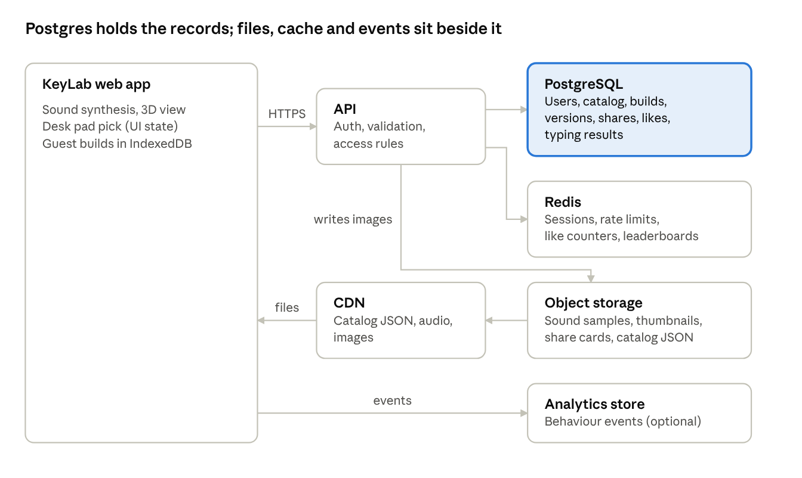
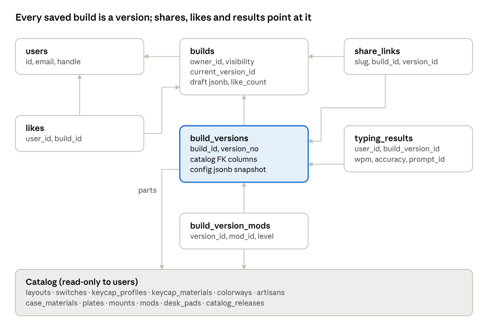

<!-- Exported from the Claude Doc "KeyLab — Database design" (https://claude.ai/artifact/JfkhofPSCTuWBPHtAYL94C) on 2026-11-12. The repo copy is the one to keep current. -->

# KeyLab — Database design

Nov 1, 2026 · @Dat

## Short answer: SQL for records, not for everything

No, not everything belongs in SQL. Put every record people create, own or share in **one PostgreSQL database**: accounts, the parts catalog, builds, share links, likes and typing results. Those are relational, need constraints and must never be lost.

Four kinds of KeyLab data fit better elsewhere:

- **Audio and images** (switch sound samples, build thumbnails, share-card images) are files. Keep them in object storage behind a CDN and store only their keys in Postgres.
- **The parts catalog read path** changes rarely and is read on every screen. Publish it as a versioned JSON file on the CDN; Postgres stays its source.
- **Sessions, rate limits and hot counters** (live like counts, typing leaderboards) live in Redis. Postgres keeps the durable totals.
- **Behaviour events** (key presses tested, mods toggled, pads picked) go to an analytics store, or nowhere. They are high-volume and nobody edits them.

What the browser does on its own also stays out of every database: sound synthesis, the 3D view angle, and the desk pad picked on a screen are UI state. Save the pad only when it becomes part of a saved build.

## What KeyLab stores

Each screen in the design reads or writes one of these kinds of data. Volume is a rough sizing guess for 10,000 monthly users, only to show which data is small and which is a firehose.

| Data | Screens | Who writes it | Volume | Changes |
| --- | --- | --- | --- | --- |
| Parts catalog: layouts, switches, keycap profiles, materials, colorways, artisans, cases, plates, mounts, mods, desk pads | All builder screens | KeyLab team | Hundreds of rows | Weekly |
| Switch sound samples and sound parameters | Switch library, Mods, Playground | KeyLab team | \~100 audio files | Rarely |
| Accounts and profiles | My builds, Share | User | 10k rows | Rarely |
| Builds and their saved versions | Every builder screen, My builds | User | \~50k rows | Often while editing |
| Per-key colour overrides, artisan keys | Keycaps studio | User | \~2M rows if stored per key | With each paint |
| Share links, likes, remixes | My builds & share | User | \~100k rows | Often |
| Typing test results | Sound playground | User | \~500k rows | Append only |
| Thumbnails and share-card images | My builds, social previews | Server, on save | \~50k files | On save |
| Behaviour events (keys tested, mods toggled, views) | All screens | Client | Millions of rows | Append only |

## Storage map



> Diagram, in words: Web app (sound synthesis, 3D view, guest builds in IndexedDB) → HTTPS → API (auth, validation, access rules) → PostgreSQL (users, catalog, builds, versions, shares, likes, typing results) and Redis (sessions, rate limits, like counters, leaderboards). The API writes images to object storage (sound samples, thumbnails, share cards, catalog JSON), served through a CDN. Behaviour events go to an optional analytics store.

The browser talks to the API for anything saved, and to the CDN for read-only files. Only the API reaches Postgres and Redis. A publish job copies the catalog from Postgres to object storage as versioned JSON.

## Entity-relationship diagram



> Diagram, in words: builds → users (owner_id); build_versions → builds (build_id) and the catalog (FK columns + config jsonb snapshot); build_version_mods → build_versions and catalog mods; likes → users and builds; share_links → builds and build_versions; typing_results → users and build_versions. Catalog tables are read-only to users. Full columns: [schema.drawio](schema.drawio).

Arrows point from a foreign key to the row it references. `typing_results.user_id` also points at `users`, left undrawn to keep the lines apart.

## Postgres schema

The schema has four groups: the catalog, accounts, builds, and sharing plus results. Ids are `uuid` for user-owned rows and short readable `text` slugs for catalog rows (`milk-yellow`, `cherry`). Every table has `created_at timestamptz default now()`, left out below.

### Catalog (written by the KeyLab team)

| Table | Key columns | Notes |
| --- | --- | --- |
| `layouts` | `id` text PK, `name`, `key_count` int, `geometry` jsonb | 60%, 65%, 75%, TKL, 100%; `geometry` holds key positions and widths |
| `switches` | `id` uuid PK, `slug` text unique, `name`, `brand`, `type` (linear, tactile, clicky, silent), `profile`, `stem_color`, `force_g`, `actuation_mm`, `travel_mm`, `bottom_out_g`, `spring`, `housing`, `force_curve` jsonb, `status` (draft, published, hidden), `sound_status`, `new_until`, `published_at`, `version` | Typed columns because the Switch library filters and sorts on them. Built in US-37 (`catalog.switches`, migration `V2__switches.sql`): the API addresses switches by UUID and `slug` (api-design-v1.md), and `force_curve` holds the points as one JSON list. Sound parameters arrive with the `sound` module. `sound_status` is `recorded` once `switch_recordings` holds the stock press and release (US-39), else `missing`. `photo_url` (US-38, `V4__switch_photo.sql`) is set from an ADM-04 photo upload |
| `switch_recordings` | (`switch_id`, `variant`, `stroke`) PK, `recording_id`, `url`, `duration_ms`, `loudness_lufs`, `peaks` jsonb, `processed_at` | US-39, `catalog.switch_recordings` (`V3__switch_recordings.sql`): catalog's copy of the ready recordings, written only by the `SoundProcessed` listener. The latest `processed_at` per slot wins; the `sound` module owns the files and their processing |
| `sound.uploads` | `id` uuid PK, `purpose` (sound, switch_photo), `content_type`, `file_name`, `status` (pending, received, used), `size_bytes`, `sha256`, `created_by`, `created_at`, `expires_at`, `received_at` | US-38 (`sound/V2__uploads_and_recordings.sql`): one presigned upload, used once. The file sits under `uploads/<id>` until used |
| `sound.recordings` | `id` uuid PK, `switch_id` (no FK, catalog's), `variant`, `stroke`, `upload_id` unique, `file_name`, `status` (processing, ready, failed), `url`, `sha256`, `duration_ms`, `loudness_lufs`, `peaks` jsonb, `error`, `created_by`, `created_at`, `processed_at` | US-38: every take; a slot can hold several and the newest ready one plays. Files are content-addressed (`sounds/<sha256>.wav`) |
| `keycap_profiles` | `id` text PK, `name`, `family` enum (sculpted, uniform), `height_mm` | Cherry, OEM, SA, XDA, MT3 |
| `keycap_materials` | `id` text PK, `name`, `sound_fx` jsonb | PBT, ABS |
| `colorways` | `id` text PK, `name`, `alpha_hex`, `mod_hex`, `accent_hex` | Preset themes such as Navy Mustard |
| `artisans` | `id` text PK, `name`, `image_key` | Arcade, Handheld, Resin |
| `keycap_sets` | `id` uuid PK, `slug` text unique, `name`, `material` (pbt, abs, pom), `profile` (cherry, oem, sa, xda), `base_hex`, `alpha_hex`, `mod_hex`, `accent_hex`, `sound_shift` numeric(3,2) -1..1, `key_count`, `status` (draft, published, hidden), `position`, `is_seed`, `updated_at` | KL2-1 (`V5__parts_catalog.sql`): what CAT-05 and CAT-06 serve, a material, profile and colourway with its shift on the deep to bright scale. Addressed by uuid and slug like a switch, because the API returns both. Only published sets are public. Seeded with AdminCatalog's six |
| `case_materials` | `id` text PK, `name`, `note`, `colors` text\[\], `sound_fx` jsonb, `is_active`, `position`, `is_seed`, `updated_at` | Aluminium, polycarbonate, plastic, wood. KL2-1: `note` is CAT-08's `soundEffect`, `colors` the case colours offered, `sound_fx` the recipe factors (`pitch`, `bright`, `decay`, `thump`) |
| `plates` | `id` text PK, `name`, `note`, `flex` smallint 0..4, `sound_fx` jsonb, `is_active`, `position`, `is_seed`, `updated_at` | Alu, brass, FR4, PC, POM |
| `mounts` | `id` text PK, `name`, `note`, `sound_fx` jsonb, `is_active`, `position`, `is_seed`, `updated_at` | Tray, gasket, top mount |
| `mods` | `id` uuid PK, `slug` text unique, `name`, `description`, `impact`, `kind` enum (toggle, level), `levels` text\[\], `sound_fx` jsonb, `live`, `position`, `is_seed`, `updated_at` | Lube, case foam, PE foam, stabilizer tuning, O-rings, spring swap (KL2-1, from ModsDesktop; AdminCatalog's Holee mod seeded switched off). `sound_fx` is `{pitch, thock, volume, rattle}`, steps -3..+3. A level mod's first level is off. `live = false` hides it from the builder (CAT-07). uuid and slug because the API returns both |
| `desk_pads` | `id` text PK, `name`, `style` jsonb, `thumb_key` | Sky, Splash, Grid, Dots, Stripes, Checker, Walnut |
| `catalog_releases` | `id` int PK, `published_at`, `cdn_key` | Each publish of the catalog JSON to the CDN |

Catalog rows are retired with `is_active = false`, never deleted, so old builds still resolve (keycap sets use `status = 'hidden'` and mods `live = false` for this). Rows from the KL2-1 seed carry `is_seed = true`; US-40 edits them like any other row. Switches use `status = 'hidden'` for this; only a draft, which no build can use, is ever deleted.

### Accounts

| Table | Key columns | Notes |
| --- | --- | --- |
| `users` | `id` uuid PK, `email` citext unique, `handle` citext unique, `display_name`, `avatar_key` | One row per person |
| `auth_identities` | `user_id` FK, `provider`, `provider_uid`, unique (`provider`, `provider_uid`) | Google, Apple, email link; skip if a hosted auth service owns this |

### Builds

| Table | Key columns | Notes |
| --- | --- | --- |
| `builds` | `id` uuid PK, `owner_id` FK users, `name`, `visibility` enum (private, public; no story uses unlisted, so it was dropped in KL2-0 to match the API), `current_version_id` FK, `draft` jsonb, `remixed_from` FK builds, `thumb_key`, `like_count` int, `updated_at`, `deleted_at` | The thing in My builds; `draft` holds unsaved edits |
| `build_versions` | `id` uuid PK, `build_id` FK, `version_no` int, unique (`build_id`, `version_no`), `layout_id`, `switch_id`, `keycap_profile_id`, `keycap_material_id`, `colorway_id`, `case_material_id`, `case_color_hex`, `plate_id`, `mount_id`, `desk_pad_id`, `config` jsonb, `schema_version` smallint | One immutable row per Save; catalog choices as FK columns |
| `build_version_mods` | `version_id` FK, `mod_id` FK, `level` smallint, PK (`version_id`, `mod_id`) | Which mods a version uses, and at what level |

### Sharing and results

| Table | Key columns | Notes |
| --- | --- | --- |
| `share_links` | `slug` text PK, `build_id` FK, `version_id` FK null, `created_by` FK users, `revoked_at` | A null `version_id` follows the latest save |
| `likes` | `user_id` FK, `build_id` FK, PK (`user_id`, `build_id`) | One like per person per build |
| `typing_prompts` | `id` int PK, `text`, `lang` | Lines for the typing test |
| `typing_results` | `id` bigint identity PK, `user_id` FK null, `build_version_id` FK null, `prompt_id` FK, `wpm` smallint, `accuracy` numeric(5,2), `duration_ms` int | Append only; `user_id` null for guests |

## How a build is stored

A saved build is split in two: the choices people search on become columns, and everything needed to redraw it goes in one `config` JSONB snapshot.

**Columns, with foreign keys:** layout, switch, keycap profile and material, colorway, case, plate, mount, desk pad and mods. These answer questions such as "most used switch this month" or "public builds with a brass plate". Foreign keys also stop a build from pointing at a part that never existed.

**`config` JSONB:** the exact colours, legend font and position, shine-through, per-key colour overrides, artisan keys on Esc and Enter, and the computed sound parameters. Nobody queries a single key's colour, and storing \~68 to 104 keys as rows per version would multiply the table for no gain. The snapshot also keeps a build drawable after its catalog parts change, and `schema_version` lets the app upgrade old snapshots.

```json
{
  "schema_version": 1,
  "colors": { "alpha": "#3D6A8C", "mod": "#1F2B45", "accent": "#F2C14E" },
  "key_overrides": { "KeyW": "#F16B53", "KeyA": "#F16B53" },
  "artisans": { "Escape": "arcade", "Enter": "handheld" },
  "legend": { "font": "grotesk", "position": "top-left", "shine_through": false },
  "sound": { "pitch": 470, "bright": 0.2, "decay": 62, "thump": 1.0 }
}
```

**Versions:** editing autosaves into `builds.draft`, overwritten in place, so slider drags never add rows. Pressing Save build writes a new immutable `build_versions` row and moves `current_version_id`. Share links and typing results point at a version, so a later edit never changes what someone already shared or tested.

**Guests:** a person who is not signed in keeps their build in the browser (IndexedDB). On sign-up, the app uploads it as their first saved build.

## Indexes, rules and scale

One Postgres instance with a read replica covers KeyLab well past launch; these indexes match the screens' queries.

| Query | Index |
| --- | --- |
| My builds, newest first | `builds (owner_id, updated_at desc) where deleted_at is null` |
| Community feed of public builds | `builds (like_count desc, updated_at desc) where visibility = 'public' and deleted_at is null` |
| Open a share link | `share_links (slug)`, the primary key |
| Versions of a build | `build_versions (build_id, version_no desc)` |
| Builds that use a mod | `build_version_mods (mod_id)` |
| Switch library filters | `switches (type, actuation_g) where is_active` |
| A person's typing history | `typing_results (user_id, created_at desc)` |

**Constraints:**

- Colour columns are `CHECK (x ~ '^#[0-9A-F]{6}$')`.
- `wpm` is between 0 and 300, and `accuracy` between 0 and 100.
- `mods.kind = 'level'` rows must have `levels`, and a version's `level` must index into them; the API checks the second rule.
- Foreign keys to the catalog are `ON DELETE RESTRICT`; foreign keys from versions, mods and likes to a build are `ON DELETE CASCADE`.
- Share slugs are 10 random base62 characters, so links can't be guessed.

**Access:** people read and write only their own builds. Public builds are readable through their share link. If the API runs on Supabase or similar, enforce this with row-level security policies; otherwise enforce it in the API layer.

**Deleting:** deleted builds keep `deleted_at` for 30 days so My builds can offer Undo, then a nightly job removes them and their images.

**Counters:** a like writes the `likes` row and bumps a Redis counter. A job copies counts into `builds.like_count` every minute, so the feed sorts without counting rows.

**When to change this:** partition `typing_results` by month, or move it to the analytics store, only once it passes about 100 million rows.

## Open decisions

- [ ] Hosting: managed Postgres with built-in auth and storage (Supabase) or separate pieces (Neon or RDS, S3, an auth service)?
- [ ] Do guests get server-side drafts, or stay in the browser until sign-up as proposed?
- [ ] Should the chosen desk pad be saved with a build, or stay a per-device preference?
- [ ] Keep behaviour events at all? If yes, pick the store (PostHog, ClickHouse or BigQuery) and a retention period.
- [ ] Are comments on shared builds in scope? The current screens have likes and remixes only.


## Full schema diagram

[schema.drawio](schema.drawio) has every table and column. Open it in draw.io / diagrams.net or the VS Code Draw.io extension.
