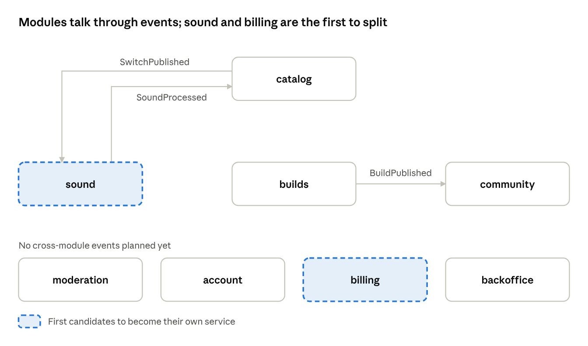

<!-- Exported from the Claude Doc "KeyLab API — Spring Modulith plan" (https://claude.ai/artifact/MXRVAFXFDMhzuUtRc6Unr4) on 2026-11-12. The repo copy is the one to keep current. -->

# KeyLab API — Spring Modulith plan

Nov 9, 2026 · @Dat

Build `keylab-api` as one Spring Modulith app with eight modules, and split a module into its own service only when it has a concrete reason to leave. The rules below keep that split cheap.

## Modules

Each module is a top-level package under the app's root package (`app.keylab`), and each owns a group of endpoints from [the KeyLab REST API design](api-design-v1.md).

| Module | Owns | API IDs |
| --- | --- | --- |
| `catalog` | Switches, keycap sets, mods, case options, publishing | CAT, ADM-02/03/06/07 |
| `sound` | Uploads, recordings, processing, sound recipe | ADM-04/05, BLD-10 |
| `builds` | Builds, parts list, share image, guest import | BLD-01…09 |
| `community` | Profiles, follows, likes, collections, activity, badges, reports | ME, SOC |
| `moderation` | Queue, decisions, featured slots | ADM-09/10 |
| `account` | Settings, identities, export, deletion, admin user actions | ACC-01/02/09/10, ADM-08 |
| `billing` | Plans, subscription, checkout, invoices, webhooks | ACC-03…08 |
| `backoffice` | Team roles, app settings, audit log, overview metrics | ADM-01, ADM-11…13 |

There is no admin module. Each module exposes its own `/v1/admin/...` controllers, so the admin code moves with the module if it is ever split out.

## Module map

> Diagram, in words: catalog —SwitchPublished→ sound; sound —SoundProcessed→ catalog; builds —BuildPublished→ community. moderation, account, billing and backoffice have no cross-module events planned yet. sound and billing are the first candidates to become their own service.

The three events shown are examples: `sound` needs to hear about published switches, `catalog` waits for `SoundProcessed` before it allows publishing, and `community` builds its activity timeline from `BuildPublished`.

Listening to an event is a dependency on the module that owns the event type. Since US-39 `catalog` listens to `SoundProcessed`, so `catalog` depends on `sound`, and `sound` must not refer to any `catalog` type (`ModularityTests` would fail on the cycle). Decided in US-38: when `sound` needs to know about a switch (does it exist, is it published), it declares a port, `sound.SwitchDirectory`, and `catalog` implements it. The dependency still points from catalog to sound, and after a split the port becomes an HTTP call. Catalog reaches uploads through `sound.SoundApi` (the switch photo) and hears of deleted takes through `SoundRemoved`. If `sound` later needs `SwitchPublished`, the same choice comes back: a port, or the type moves to `shared`.

## Package structure

One Spring Boot app, root package `app.keylab`. Every direct sub-package is a
Spring Modulith application module, which is one DDD bounded context with its
own Postgres schema. Inside a module, code follows ports and adapters
(hexagonal): the domain knows nothing about HTTP, JSON, SQL or Spring.

### Inside a module with real business rules (catalog, sound, builds, billing)

    catalog/
      CatalogApi.java, SwitchPublished.java   public: the only types other modules may use
      domain/          aggregates, value objects, domain events, domain errors,
                       outbound ports (interfaces such as Switches)
                       no Spring, Jackson, jakarta or problem+json imports
      application/     use cases (AddSwitch, EditSwitch, PublishSwitch, ...):
                       load an aggregate through a port, call it, save it;
                       transactions live here
      query/           read side: SQL straight to read models for lists and
                       detail pages; never loads aggregates
      adapter/in/web/      controllers; JSON <-> domain; domain errors -> RFC 9457
      adapter/in/events/   @ApplicationModuleListener handlers that call use cases
      adapter/out/persistence/  JDBC implementations of the domain ports
      adapter/out/<module>/     implementations of ports another module declares
                                (catalog's adapter/out/sound implements sound.SwitchDirectory)

Dependencies point inwards: adapter -> application -> domain, and query is
used only by adapter/in/web. A module that needs something from another
module declares a port in its own domain (or public API) and the other module
implements it, or it listens to the other module's events.

### Inside a thin module (backoffice, moderation, account)

Forms over data with few rules: controller -> application service -> JDBC is
fine. Add a domain package only when a real rule appears.

### Enforcement

- `ModularityTests`: `ApplicationModules.verify()` (no cycles, only public
  API used across modules) and the Documenter.
- jMolecules hexagonal annotations and its ArchUnit rules fail the build when
  the domain imports an adapter, Spring, Jackson or problem+json types.

## Rules that keep a later split cheap

Follow these from day one; each one removes a piece of work you would otherwise face when a module leaves.

1. **One schema per module.** Use a Postgres schema per module (`catalog.*`, `builds.*` and so on). No joins or foreign keys across modules; refer to other modules' records by ID only. Splitting a module out then means moving its schema, not untangling joins.
2. **Talk through events by default.** For example `SwitchPublished`, `SoundProcessed`, `BuildPublished` and `UserFollowed`, handled with `@ApplicationModuleListener`. Modulith's event publication registry stores each event in the same transaction as the change that raised it (the outbox pattern), so nothing is lost on a crash.
3. **Keep direct calls few and explicit.** Expose them through `@NamedInterface` and pass IDs, not entities. Each of these calls becomes an HTTP call after a split.
4. **Share almost no code between modules.** IDs and money types at most. Never JPA entities.
5. **Let the build enforce it.** A test runs `ApplicationModules.of(KeylabApplication.class).verify()`, and each module has its own `@ApplicationModuleTest`. A cycle or a reach into another module's internals fails CI.
6. **Turn events into broker messages when you split.** Mark the events that cross a split line with `@Externalized` and add `spring-modulith-events-kafka` or `-amqp`. They are then sent to the broker with the same registry protecting them ([Spring Modulith docs](https://github.com/spring-projects/spring-modulith/blob/2.1.0/src/docs/antora/modules/ROOT/pages/events.adoc)).

Infrastructure tables that belong to no module live in a ninth schema, `platform`: the
`Idempotency-Key` store and Modulith's `event_publication` table
(`spring.modulith.events.jdbc.schema=platform`). No module reads them directly. A split-out
service gets its own copy. The paging types are `PageQuery` and `PageResult`, not `PageRequest`
and `Page`, so they never clash with Spring Data's.

The REST API does not change through any of this. The gateway already routes `/bff/keylab/v1/**`, so a split-out service gets one more route by path prefix, such as `/v1/admin/sounds/**`. URLs, `/v1` versioning and Keycloak auth stay the same, because every service checks the same token and `users.id` is the Keycloak `sub`.

## Where splitting pays off, and where it doesn't

`sound` and `billing` are the first two candidates to become their own services; `catalog`, `builds` and `community` should stay in the monolith unless something forces a split.

| Module | Decision | Why |
| --- | --- | --- |
| `sound` | Split first | Processing recordings is CPU- and storage-heavy, already asynchronous (it answers `202`), and needs to scale on its own. |
| `billing` | Split second | Its webhooks come straight from the payment provider, and it is better isolated from everything else. |
| `catalog` + `builds` | Keep together | The sound recipe (BLD-10) runs on every toggle and needs catalog data; a split adds a network hop to the hottest path. If `sound` leaves, it keeps its own read-only copy of catalog data, updated by catalog events. |
| `community` | Keep | Mostly reads and joins across profiles, follows and likes, so a split gains little. |

A good reason to split is that a module needs to scale on its own, ship on a different schedule, be owned by a different team, or be kept apart so its failures don't spread. “Microservices on principle” is not a reason: each split costs eventual consistency, distributed tracing and one more thing to deploy.

## Open questions

- [x] Which Spring Modulith release matches Spring Boot 4.1? 2.1.0 (BOM `spring-modulith-bom`), checked in KL0 against Boot 4.1.2: `ModularityTests` and the JDBC event registry work.
- [ ] Kafka or RabbitMQ for externalized events once `sound` splits out?
